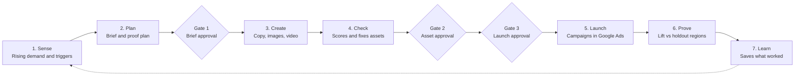

# Kairo — Business Requirements Document

*12 October 2026 · Prepared by Talha*

Kairo takes a marketer from a rising demand signal to a live, on-brand Google Ads campaign in under an hour, and proves the campaign's incremental impact with a built-in holdout test. It runs for one brand per workspace, through Google Ads Search, Shopping and Demand Gen campaigns. It also reacts to real-world moments, protects campaigns after launch and measures the impact of any marketing change.

## 1. Business problem

Marketers can see demand change every day, but their campaign process takes weeks, so most demand spikes pass before the ads go live.

| Problem today | Business impact |
| --- | --- |
| Demand moves faster than campaigns. A heatwave, a festival or a viral moment peaks within days, while briefing, creative and launch can take weeks. | Sales missed at the peak of demand. |
| The work is scattered across insight tools, creative tools, ad platforms and reports. Context is re-typed at every step. | Slow handoffs, and learnings never reach the next campaign. |
| Creative can't keep up. Every channel needs more formats, sizes and languages than a small team can make, and AI at scale risks going off-brand. | Channels left under-served, brand risk and disapproved ads. |
| Impact is guesswork. Most campaigns launch without a test plan. | Budgets follow clicks rather than proven sales. |

The opportunity: Google's AI models and ad platforms now make it possible to go from demand signal to launch in hours, keep brand control with automated checks, and plan measurement before launch.

## 2. Objectives and success metrics

Kairo succeeds when marketers act on demand the same day, approve rather than build, and get a proven lift figure for every campaign. These targets are initial and will be confirmed in the pilot.

| Objective | KPI | Target |
| --- | --- | --- |
| Act on demand faster | Time from accepting an opportunity to a launch-ready campaign | Under 60 minutes |
| Act on real-world moments | Time from a trigger firing to a draft brief ready for review | Under 15 minutes |
| Cut manual effort | Marketer steps needed per campaign | 3 approvals, plus optional edits |
| Protect the brand | Assets that pass Brand Guardian before human review | 90% or more |
| Avoid policy problems | Ads disapproved after launch | Under 5% |
| Stop wasted spend | Ads still running for out-of-stock products | None, within 1 hour of the stock update |
| Prove impact | Campaigns launched with a locked proof plan | 100% |
| Prove impact | Campaigns with a completed impact report at the end of the test | 80% or more |

## 3. Scope

Kairo delivers the full loop, from opportunity to proven result, for one brand on Google's ad channels. Nothing that launches a campaign or raises spend happens without a person's approval.

### In scope

- Brand Kit built from the brand's website, Google Ads account, guidelines and product catalogue.
- Opportunity Radar: a daily feed of rising demand matched to the catalogue.
- Real-world triggers: weather, festival and stock signals that create opportunities with a pre-drafted brief.
- One campaign room per opportunity, shared by every agent and user.
- Smart Brief with a built-in proof plan using holdout regions.
- Creative Studio: search ads, Demand Gen ads, product images, vertical video with voiceover, shopping titles and regional-language versions.
- Brand Guardian checks with automatic fixes.
- Approval and launch to Google Ads as Search, Shopping and Demand Gen campaigns. Demand Gen runs image and video ads on YouTube (including Shorts), Discover, Gmail and the Google Display Network.
- Post-launch care: automatic pausing of ads for out-of-stock products, pacing alerts, and budget and bid-target recommendations.
- Impact report and Brand Memory.
- Impact Lab: measuring marketing changes made outside Kairo, such as a TV burst or a price change.
- Ask Kairo, a chat assistant on every screen.
- A single-brand workspace with Google sign-in, roles and approvals.

### Out of scope

- Launching campaigns or raising spend without a person's approval. The only automatic actions are pausing ads for out-of-stock products and resuming them when stock returns, within the approved budget.
- Auction-level bid management, which stays with Google Ads Smart Bidding.
- Performance Max campaigns.
- An agency workspace for many brands with shared learnings.
- Buying through Display & Video 360, Search Ads 360 or ad platforms other than Google.

## 4. Users and stakeholders

The performance marketer runs Kairo day to day. Approvers and leaders step in at the approval gates, for recommendations, and when results are ready.

| Role | What they do in Kairo | What they need |
| --- | --- | --- |
| Performance marketer (primary user) | Reviews opportunities and triggers, shapes briefs, edits assets, requests launches and acts on recommendations | Speed, clear reasoning and control over spend |
| Brand or creative reviewer | Approves assets against brand standards | Brand rules applied the same way every time, with a before-and-after view of each fix |
| Marketing head or budget owner | Approves briefs and recommendations above the budget limit, and reads impact reports and Impact Lab results | Proven lift, cost per extra sale and a clear next step |
| Agency account manager | Runs Kairo for a client brand | Client-ready briefs and reports, plus an approval trail |
| Workspace admin | Manages users, roles, connections, trigger rules and the Brand Kit | Secure access and simple setup |

## 5. Workflow

Agents run every stage. A person approves the brief, the assets and the launch, and each impact report feeds the next round of opportunities. Real-world triggers enter at Sense, and post-launch recommendations come out of Prove.

## 6. Functional requirements

Each feature below lists what Kairo must do. Priority: Must = required at launch; Should = expected soon after launch; Could = nice to have.

### 6.1 Brand Kit and onboarding

The Brand Kit is set up once, and every agent works from it.

| ID | Requirement | Priority |
| --- | --- | --- |
| FR-1.1 | Connect a Google Ads account through Google sign-in, to read performance data and create campaigns. | Must |
| FR-1.2 | Build a draft Brand Kit from the brand's website: tone of voice, colours, logo, key messages and product categories. | Must |
| FR-1.3 | Learn the brand's voice from its best-performing ads in the connected account. | Must |
| FR-1.4 | Let users upload brand guidelines and set rules: banned words, required disclaimers, tone and competitor mentions. | Must |
| FR-1.5 | Import the product catalogue by file upload or feed link, with title, description, price, link, image, category and stock status. | Must |
| FR-1.6 | Let users review and edit everything Kairo learned. Keep versions, and have agents always use the latest approved one. | Should |

### 6.2 Opportunity Radar

The Radar turns daily search demand into a ranked list of opportunities the brand can act on.

| ID | Requirement | Priority |
| --- | --- | --- |
| FR-2.1 | Refresh opportunities every day for the brand's categories and products, using Google Ads keyword data. | Must |
| FR-2.2 | Show each opportunity as a card: the search trend over time, growth rate, regions where it is rising, matching products, and why it is rising, grounded in Google Search with sources. | Must |
| FR-2.3 | Match each opportunity to in-stock catalogue products, and hide opportunities with no matching product. | Must |
| FR-2.4 | Rank opportunities by a score built from growth, search volume and product fit, and explain the score. | Must |
| FR-2.5 | Let users accept an opportunity (which opens a campaign room), dismiss it with a reason, or save it for later. | Must |
| FR-2.6 | Let users add topics to watch and topics to ignore. | Should |

### 6.3 Real-world triggers

Kairo watches weather, festivals and stock levels, and turns a matching moment into a ready-to-review opportunity. A person still approves before anything runs.

| ID | Requirement | Priority |
| --- | --- | --- |
| FR-3.1 | Let users set trigger rules per product category: weather conditions by region (for example, heavy rain or a heatwave), festival and event dates, and stock thresholds. | Must |
| FR-3.2 | Check trigger sources on a schedule: weather forecasts at least hourly, the festival calendar daily, and stock levels on every catalogue update. | Must |
| FR-3.3 | When a rule fires, create an opportunity card with the trigger, the regions affected, matching in-stock products and a pre-drafted brief. | Must |
| FR-3.4 | Send every triggered opportunity through the normal approval gates. Never launch or raise spend automatically. | Must |
| FR-3.5 | Show each trigger rule's past results for the brand, so users can keep rules that work and pause those that don't. | Should |
| FR-3.6 | Suggest new trigger rules from Brand Memory, for example "rain lifts waterproof footwear sales in Mumbai". | Could |

### 6.4 Campaign room

Each campaign lives in one shared record, so nobody re-enters context between stages.

| ID | Requirement | Priority |
| --- | --- | --- |
| FR-4.1 | Create a campaign room for each accepted opportunity, holding its evidence, brief, assets, checks, approvals, launch details and results. | Must |
| FR-4.2 | Show a stage tracker with the current stage, its owner and the next action. | Must |
| FR-4.3 | Let every agent read from and write to the room, so each stage picks up where the last one ended. | Must |
| FR-4.4 | Log every agent and user action with its time and who did it. | Must |
| FR-4.5 | List all campaign rooms, with filters for stage, status, owner and date. | Must |

### 6.5 Smart Brief and proof plan

The brief turns an opportunity into a campaign plan, with its measurement designed before launch.

| ID | Requirement | Priority |
| --- | --- | --- |
| FR-5.1 | Draft a brief from the opportunity: objective, KPI, campaign types (Search, Shopping, Demand Gen), budget, dates, regions, audiences, key messages, products and landing pages. | Must |
| FR-5.2 | Show the reasoning and evidence behind each recommendation in the brief. | Must |
| FR-5.3 | Let users edit any field directly or with a plain-language instruction. The brief re-checks itself after each change. | Must |
| FR-5.4 | Enforce a per-campaign budget limit set by the admin. A brief above the limit needs the budget owner's approval. | Must |
| FR-5.5 | Propose holdout regions matched to the test regions on past sales, conversions and search demand. Users can swap them from a ranked list. | Must |
| FR-5.6 | Show the test window and the smallest lift the test can detect. Warn when the data is too thin for a reliable result. | Must |
| FR-5.7 | Lock the proof plan at launch. Log any later change and flag it in the impact report. | Must |
| FR-5.8 | Require brief approval (gate 1) before any creative work starts. | Must |

### 6.6 Creative Studio

One approved brief produces every asset the campaign needs, in the brand's voice.

| ID | Requirement | Priority |
| --- | --- | --- |
| FR-6.1 | Generate keywords and responsive search ads for each ad group: up to 15 headlines and 4 descriptions, within Google Ads character limits. | Must |
| FR-6.2 | Generate on-brand product and lifestyle images in the sizes each campaign type needs, using catalogue photos as reference so products look accurate. | Must |
| FR-6.3 | Generate a short vertical video (for example, 15 seconds) from the brief and product images, with script, voiceover, captions and logo. | Must |
| FR-6.4 | Write improved shopping titles for the matched products, ready for the product feed. | Must |
| FR-6.5 | Produce regional-language versions of copy and voiceover for the languages set in the brief. | Must |
| FR-6.6 | Let users edit any asset inline, regenerate a single asset with instructions, and lock assets they want to keep. | Must |
| FR-6.7 | Record how each asset was generated, and support the AI disclosure labels that ad platforms require. | Must |
| FR-6.8 | Write Demand Gen ad text (headlines, descriptions and call to action) within Google Ads limits, paired with the brand's logo and business name. | Must |

### 6.7 Brand Guardian

Every asset is checked and, where needed, fixed before a person sees it.

| ID | Requirement | Priority |
| --- | --- | --- |
| FR-7.1 | Check every asset against brand rules, Google Ads policy risks and technical specs (length, size, aspect ratio, duration), and check videos against YouTube's ABCD creative principles. | Must |
| FR-7.2 | Score each asset and the full set, and explain every issue in plain words. | Must |
| FR-7.3 | Fix failing assets automatically and re-check them, up to a set number of attempts. Flag anything still failing to the reviewer. | Must |
| FR-7.4 | Show a before-and-after view of every automatic fix. | Must |
| FR-7.5 | Require asset approval (gate 2). Reviewers can override a flag with a reason, which is logged. | Must |
| FR-7.6 | Let admins tune brand rules and pass thresholds for the brand. | Should |

### 6.8 Approve and launch

Nothing goes live until a person approves it. Kairo then builds the whole campaign in Google Ads.

| ID | Requirement | Priority |
| --- | --- | --- |
| FR-8.1 | Show a launch summary (budget, dates, regions, holdout regions, campaign types and assets) and require launch approval (gate 3). | Must |
| FR-8.2 | Create the Search, Shopping and Demand Gen campaigns, with their ad groups, keywords, ads and assets, in the connected Google Ads account. Set budget, schedule and targeting, and exclude holdout regions. | Must |
| FR-8.3 | Upload approved videos to the brand's YouTube channel as unlisted, so Demand Gen video ads can use them. | Must |
| FR-8.4 | Never create or turn on anything that spends money without launch approval. | Must |
| FR-8.5 | Save every Google Ads ID in the campaign room, and show launch status with a plain-language fix for any error. | Must |
| FR-8.6 | Make launch safe to retry, so a retry never creates duplicates. | Must |
| FR-8.7 | Run a health check 24 hours after launch (ad approvals, delivery started) and alert the marketer to any problem. | Should |

### 6.9 Post-launch care

After launch, Kairo protects spend automatically and suggests improvements, but only a person can raise spend or change targets.

| ID | Requirement | Priority |
| --- | --- | --- |
| FR-9.1 | Pause search and Demand Gen ads for products that go out of stock, and resume them when stock returns, within the approved budget. Shopping ads already stop through the product feed. | Must |
| FR-9.2 | Log every automatic pause and resume in the campaign room, and notify the marketer. | Must |
| FR-9.3 | Track daily pacing against the budget and the test plan, and alert the marketer to under- or over-delivery. | Must |
| FR-9.4 | After the test window, recommend budget moves between campaigns (scale winners, cut losers) and changes to bid-strategy targets, with the expected effect and the reasoning. | Must |
| FR-9.5 | Apply a recommendation only after one approval, and log it. | Must |
| FR-9.6 | Hold budget and target recommendations while a test is running, unless the marketer chooses to end the test early. | Must |
| FR-9.7 | Show Google Ads' own recommendations for the campaign, and let the marketer apply them with one approval. | Could |

### 6.10 Impact report and Brand Memory

Every campaign ends with a measured answer to "did it work?", and that answer shapes the next campaign.

| ID | Requirement | Priority |
| --- | --- | --- |
| FR-10.1 | At the end of the test window, measure the extra orders, conversions or revenue in test regions against holdout regions, with a confidence range. | Must |
| FR-10.2 | Show spend, results, extra results, cost per extra result and a plain-language summary. | Must |
| FR-10.3 | Recommend the next step (scale up, change or stop) with the reasoning. | Must |
| FR-10.4 | Explain an inconclusive result and what would make the next test conclusive. | Must |
| FR-10.5 | Show interim readings during the test, clearly marked as early. | Should |
| FR-10.6 | Save winning and losing messages, visuals, audiences and regions to Brand Memory, with their results. | Must |
| FR-10.7 | Use Brand Memory when drafting new briefs and assets, and when ranking new opportunities. | Must |
| FR-10.8 | Let users view, edit and remove Brand Memory entries. | Should |

### 6.11 Impact Lab

Impact Lab measures marketing changes made outside Kairo, such as a TV burst, a price drop or a new store, with the same analysis as the impact report.

| ID | Requirement | Priority |
| --- | --- | --- |
| FR-11.1 | Let users describe a change: what happened, when it started and ended, and which regions or products it affected. | Must |
| FR-11.2 | Pull outcome data from Google Ads, Google Analytics 4, BigQuery or an uploaded file. | Must |
| FR-11.3 | Suggest comparison data the change did not affect (unaffected regions, products or related series), and let users adjust it. | Must |
| FR-11.4 | Estimate the change's effect with a confidence range, and explain it in plain words. | Must |
| FR-11.5 | Warn clearly when the history is too short, the data too noisy or the comparison too weak for a reliable answer. | Must |
| FR-11.6 | Save each result to Brand Memory, and let users share or download it. | Should |

### 6.12 Ask Kairo

A chat assistant on every screen explains Kairo's decisions and makes changes on request.

| ID | Requirement | Priority |
| --- | --- | --- |
| FR-12.1 | Provide a chat panel on every screen that knows what the user is looking at: an opportunity, a brief, an asset, a report or an Impact Lab result. | Must |
| FR-12.2 | Answer "why" questions (for example, "Why Pune?") with evidence from the campaign room and cited sources. | Must |
| FR-12.3 | Make changes on request (for example, "Make the video more festive"), with a preview and confirmation before applying. | Must |
| FR-12.4 | Never launch or raise spend from chat without the standard approval gates. | Must |
| FR-12.5 | Answer questions across past campaigns (for example, "What worked last month?"). | Should |

### 6.13 Users, roles and notifications

People sign in with Google, and roles decide who can edit and who can approve.

| ID | Requirement | Priority |
| --- | --- | --- |
| FR-13.1 | Let users sign in with their Google account. | Must |
| FR-13.2 | Support three roles: admin (connections, users, Brand Kit, trigger rules), marketer (create and edit) and approver (briefs, assets, launches and recommendations). One person may hold several roles. | Must |
| FR-13.3 | Let admins choose who approves each gate and each type of recommendation. | Must |
| FR-13.4 | Keep an audit log of approvals, overrides, automatic pauses and changes. | Must |
| FR-13.5 | Notify users in the app and by email about new top opportunities, fired triggers, pending approvals, automatic pauses, recommendations, launch problems and ready reports. | Should |

## 7. Non-functional requirements

Kairo must be fast enough to catch a trend, safe enough to trust with ad spend, and clear about why it acts. Times below are targets.

| Area | Requirement |
| --- | --- |
| Speed | Daily opportunity refresh done by 07:00 local time, and weather triggers checked at least hourly. Brief drafted in under 1 minute, copy and images in under 5 minutes, video in under 15 minutes, launch in under 5 minutes. Out-of-stock pauses applied within 1 hour of the stock update. |
| Availability | 99.5% monthly uptime for the web app. Long-running agent jobs resume after a failure without losing work. |
| Security | Google sign-in, least-privilege access to Google Ads, secrets in Secret Manager, data encrypted in transit and at rest, and service access controlled with IAM. |
| Data privacy | Each brand's data kept separate. No personal customer data needed; sales data used in aggregate by region and day. |
| Spend safety | No launch or spend increase without approval. Automatic actions limited to pausing and resuming ads for stock. Budget limits enforced, and every agent action logged. |
| Explainability | Every recommendation, trigger and result shows its reasoning and evidence. |
| Compliance | Ads checked against Google Ads policies, AI-generated content disclosed where required, and data retention set per brand. |
| Languages | Interface in English. Content in English and at least one regional language (Hindi) at launch, with more added by configuration. |
| Scalability | Generation and analysis run as parallel background jobs, so one brand can run many campaigns at once. |
| Monitoring | Logs and alerts for every agent step and integration, including sudden spikes in automatic pauses. |

## 8. Integrations and data

Kairo runs on Google Cloud and connects to Google's ad and AI services, plus the brand's own data.

| System or data | Used for |
| --- | --- |
| Google Ads API | Keyword and performance data; creating Search, Shopping and Demand Gen campaigns; pausing and resuming ads; budget and bid-target changes; Google Ads recommendations. Connected per brand through Google sign-in. |
| YouTube Data API | Uploading approved videos to the brand's YouTube channel, as unlisted, for use in Demand Gen ads |
| Google Maps Platform Weather API | Hourly and daily weather forecasts by region for trigger rules |
| Festival and event calendar | Date-based trigger rules, kept per market |
| Google Analytics 4 | Outcome data for Impact Lab |
| Grounding with Google Search | Explaining why demand is rising, with sources |
| Gemini models on Agent Platform, with Google's Agent Development Kit | Reasoning, copy, checks and chat across the agents |
| Imagen and Gemini image generation | Product and lifestyle images |
| Veo | Vertical video |
| Text-to-Speech | Voiceover in each language |
| BigQuery | Campaign results, sales data, lift analysis and Impact Lab data |
| Firestore | Brand Kits, campaign rooms and trigger rules |
| Cloud Storage | Generated images and videos |
| Cloud Run | Hosting the web app and the agent service |
| Brand website | Building the Brand Kit |
| Product catalogue (file or feed link) | Matching products to opportunities, writing shopping titles, and stock levels for triggers and pauses |
| Brand sales data (optional, uploaded or in BigQuery) | Measuring lift beyond Google Ads conversions |

## 9. Assumptions and dependencies

Kairo depends on the brand's Google Ads setup, timely stock data and enough history to run fair tests.

- The brand has an active Google Ads account with conversion tracking, and Kairo has Google Ads API access.
- Shopping campaigns use a Merchant Center account already linked to the brand's Google Ads account.
- The brand connects its YouTube channel, where approved videos are uploaded as unlisted for use in ads.
- The product catalogue includes stock status. For stock-out pauses and stock triggers, stock levels update at least hourly.
- There are at least 8 weeks of history by region, so holdout regions can be matched and Impact Lab has enough data before each change.
- The brand agrees to hold out some regions for the length of each test.
- A festival and event calendar is kept up to date for each market.
- A person reviews every AI-generated asset before launch.
- The required Google AI models and quotas are available in the chosen Google Cloud region.

## 10. Risks and mitigations

The biggest risks are off-brand AI output, automation acting on bad data, and results too weak to prove; each is handled inside the workflow.

| Risk | Mitigation |
| --- | --- |
| AI content is off-brand or inaccurate | Brand Kit rules, Brand Guardian checks and fixes, and human approval of every asset |
| Ads are disapproved after launch | Policy checks before review, and a health check 24 hours after launch |
| A trend or trigger is false or fades fast | Evidence and sources on every card, approval for every trigger, budget limits, and early readings during the test |
| A broken stock feed pauses ads by mistake | Pause only on confirmed stock-outs, alert on sudden mass pauses, and one-click resume |
| Recommendations clash with Google's Smart Bidding | Recommend budgets and targets only, never auction bids, and hold changes during tests |
| Too little data for a reliable lift or Impact Lab result | Data checks before each test or analysis, longer windows, and clear caveats on inconclusive results |
| Holdout regions cost some short-term sales | Small, matched holdouts, with the expected cost of the test shown in the brief |
| Video generation is slow or costly | Background jobs and a generation limit per campaign |
| Google API limits or changes | Retries, monitoring and planned API version updates |

## 11. Open questions

These decisions are needed before the build starts.

- [ ] Which regional languages ship at launch besides Hindi?
- [ ] What minimum budget and test window must a campaign have before a lift result is reported?
- [ ] Who approves each gate by default: the brand team or the agency?
- [ ] Should shopping titles be pushed to Merchant Center, or exported for the brand to upload?
- [ ] Which outcome is the default for measuring lift: Google Ads conversions or the brand's own sales data?
- [ ] Who maintains the festival and event calendar for each market?
- [ ] Can each brand supply hourly stock updates, or only daily?
- [ ] Who can approve post-launch recommendations: the marketer, or only the budget owner?

## 12. Glossary

| Term | Meaning |
| --- | --- |
| Opportunity | A rising demand signal matched to products the brand sells |
| Trigger rule | A condition, such as heavy rain in a region, that creates an opportunity when it is met |
| Campaign room | The single shared record for one campaign, from evidence to results |
| Brand Kit | The brand's voice, visual identity, rules, products and best ads, used by every agent |
| Brand Memory | What past campaigns proved worked or failed, used to shape future ones |
| Holdout region | A region deliberately left out of a campaign, so results can be compared against it |
| Lift | The extra sales or conversions a campaign caused, measured against holdout regions |
| Impact Lab | Kairo's tool for measuring the effect of marketing changes made outside Kairo |
| Approval gate | A point where a person must approve before Kairo continues: brief, assets or launch |
| Pacing | How spend is tracking against the planned budget over time |
| Smart Bidding | Google Ads' automated bidding, which sets the bid in each auction |
| Demand Gen | A Google Ads campaign type that shows image and video ads on YouTube (including Shorts), Discover, Gmail and the Google Display Network |
| Responsive search ad | A Google search ad assembled from up to 15 headlines and 4 descriptions |
| YouTube ABCD | Google's creative principles for video ads: Attract, Brand, Connect, Direct |
