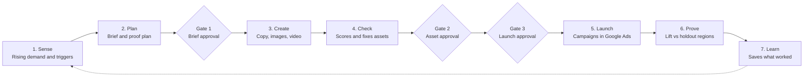

# Kairo — Product Requirements Document

*12 October 2026 · Prepared by Talha*

Kairo takes a marketer from a rising demand signal to a live, on-brand Google Ads campaign in under an hour, then proves the extra sales it caused. This PRD sets out who uses Kairo, the journeys they take, the screens, user stories with acceptance criteria, how the agents behave and what must be true before it goes live. Business goals, scope and the numbered requirements (FR-x.x) are in the Kairo Business Requirements Document (BRD).

## 1. Product overview

Kairo is an AI growth team for performance marketers at retail and direct-to-consumer brands. Seven agents find rising demand, plan the campaign, create and check the ads, launch them and measure the lift, while a person approves three times. It runs Search, Shopping and Demand Gen campaigns in Google Ads, for one brand per workspace.

Agents run every stage and a person approves at each gate. Triggers enter at Sense, and during the test Kairo pauses ads for out-of-stock products and tracks pacing.

### Product principles

| Principle | What it means in the product |
| --- | --- |
| Agents propose, people decide | Nothing launches or raises spend without approval. The only automatic actions are pausing and resuming ads for stock. |
| One campaign room | Every stage reads from and writes to one shared record, so nobody re-types context. |
| Proof by design | Every campaign gets holdout regions and a test window before it launches. |
| Show the why | Every opportunity, score, recommendation and result shows its evidence and sources. |
| Brand-safe by default | Brand Guardian checks every asset before a person sees it. |
| Learn every cycle | Results go to Brand Memory and shape the next brief, assets and opportunity ranking. |

### Goals and non-goals

Kairo's targets are the BRD's success metrics; section 10 shows how each one is measured. Kairo will not:

- Launch campaigns or raise spend without a person's approval.
- Set auction-level bids, which Google Ads Smart Bidding handles.
- Change campaigns it did not launch. It reads them only for data.
- Create Performance Max campaigns.
- Buy media through Display & Video 360, Search Ads 360 or non-Google platforms.
- Offer a multi-brand agency workspace.

## 2. Personas

Priya, the performance marketer, uses Kairo every day. The others step in at approval gates or when results arrive.

| Persona | Kairo role | Main jobs in Kairo | Success looks like |
| --- | --- | --- | --- |
| Priya, performance marketer (primary user) | Marketer, and approver within the budget limit | Checks Today each morning, accepts opportunities, shapes briefs, edits assets, approves launches within her limit and acts on alerts | A trend becomes a live campaign the same day, with proof of what it earned |
| Arjun, brand reviewer | Approver for assets | Reviews flagged assets and automatic fixes, then approves the asset set | Only on-brand, accurate ads go live, without checking every variant by eye |
| Meera, marketing head and budget owner | Approver above the budget limit and for recommendations | Approves larger spend and recommendations, and reads impact reports and Impact Lab results | Budget follows proven lift and cost per extra sale |
| Kabir, agency account manager | Marketer or approver | Runs Kairo for a client brand and shares briefs and reports for sign-off | Client approval with a clean audit trail |
| Neha, workspace admin | Admin | Connects accounts and manages users, approvers, budget limits, trigger rules and the Brand Kit | Simple, secure setup without chasing access |

## 3. User journeys

Six journeys cover the product. The example is a footwear brand in India as the monsoon arrives early; all figures are illustrative.

### 3.1 Set up the workspace

1. Neha signs in with Google and creates the brand's workspace.
2. She connects Google Ads, the YouTube channel and the product catalogue, and optionally Google Analytics 4 and BigQuery.
3. Kairo reads the website and the best-performing ads, then drafts the Brand Kit: voice, colours, logo, key messages and product categories.
4. Neha adds guidelines and rules, sets the per-campaign budget limit and picks the approvers for each gate.
5. She approves the Brand Kit, invites the team and sets up trigger rules. The first Radar refresh runs straight away.

### 3.2 From opportunity to live campaign

1. **09:00.** Priya opens Today. Searches for waterproof sneakers are up 180% month on month in Mumbai and Pune, and 14 matching products are in stock.
2. She opens the card, checks the trend, regions and sourced reasons, and accepts it. A campaign room opens.
3. **09:05.** The brief is ready: Search, Shopping and Demand Gen, ₹2 lakh over 14 days, with Nagpur and Nashik held out. She types "add Hindi and lead with quick-dry", and the brief updates.
4. The budget is within her limit, so she approves the brief (gate 1).
5. **09:20.** Kairo has created 15 headlines, 4 descriptions, 6 product images, a 15-second vertical video with Hindi voiceover and new shopping titles. Brand Guardian has fixed three issues, including a headline over 30 characters.
6. Arjun checks the before-and-after fixes and approves the assets (gate 2).
7. **09:30.** Priya reviews the launch summary and approves (gate 3). Kairo uploads the video to YouTube as unlisted and builds the three campaigns, excluding the holdout cities.

### 3.3 A triggered campaign

1. Neha has set a rule: when heavy rain is forecast where waterproof footwear sells, suggest a campaign.
2. The hourly forecast shows heavy rain in Bengaluru for the next three days, so the rule fires.
3. Within 15 minutes, a trigger card on Today shows the forecast, regions, matching in-stock products and a pre-drafted brief.
4. Priya reviews it, and the campaign follows journey 3.2 from step 3, with the same three approvals.
5. If nobody accepts it before the rain passes, the opportunity expires.

### 3.4 After launch

1. **Day 1.** The health check finds every ad approved and delivering.
2. **Day 3.** A stock update shows two products sold out. Within an hour Kairo pauses their Search and Demand Gen ads and tells Priya. Their Shopping ads stop through the feed.
3. **Day 5.** Stock returns, and Kairo resumes the ads.
4. **Day 6.** Pune is spending 25% behind plan because searches dipped. Kairo explains why and holds budget changes until the test ends.

### 3.5 Prove the impact

1. **Day 14.** The test ends. Orders in Mumbai and Pune rose 12% against the holdout cities (range 6% to 18%), at ₹310 per extra order.
2. The report recommends scaling up and moving budget from the weakest campaign to the strongest. Meera approves, and Kairo applies the change.
3. The winning "quick-dry" message and the Hindi video go to Brand Memory. Kairo suggests a new trigger rule: rain lifts waterproof footwear sales in Mumbai.

### 3.6 Measure an outside change

1. Meera asks whether last month's 10% price cut on running shoes worked.
2. Priya opens Impact Lab, describes the change and its dates, and picks units sold from Google Analytics 4 as the outcome.
3. Kairo suggests walking shoes, whose price did not change, as the comparison and confirms there are at least 8 weeks of history.
4. The result shows the effect with a confidence range and a plain explanation. Priya saves it to Brand Memory and shares it as a PDF.

## 4. Navigation and key screens

Kairo is a desktop web app with seven areas in a left-hand menu, and Ask Kairo opens as a side panel on every screen. Approval screens also work in a phone browser.

| Screen | What it shows | What users do |
| --- | --- | --- |
| Today | Approvals waiting, alerts (stock pauses, pacing, disapprovals), top opportunities and live tests | Open an item, approve, clear an alert |
| Opportunities | Ranked cards with trend line, growth, regions, matching products, score and reason; triggered cards marked with their source | Accept, save or dismiss with a reason; filter; manage watched and ignored topics |
| Opportunity detail | Trend chart, regional view, matching products, sourced reasons and score breakdown | Accept, save or dismiss; ask Kairo |
| Campaigns | Every campaign room with stage, status, owner, budget, dates and lift | Filter, search, open a room |
| Campaign room | Stage tracker with owner and next action; tabs for Evidence, Brief, Assets, Launch, Performance and Results; the activity log | Work through the stages and approvals |
| Brief tab | Each field with its reasoning, budget against the limit, test and holdout regions on a map, test window and smallest detectable lift | Edit fields or type an instruction, swap holdouts, approve gate 1 |
| Assets tab | Assets by campaign type and language, each with its Guardian score, issues and before-and-after fixes | Edit, regenerate with an instruction, lock, override a flag with a reason, approve gate 2 |
| Launch tab | Launch summary and checks, then launch progress and Google Ads IDs | Approve gate 3, retry a failed step |
| Performance tab | Pacing against plan, daily spend and results, early lift readings, the automatic pause log and recommendations | Approve or dismiss recommendations, pause the campaign, end the test early |
| Results tab | The impact report: lift with confidence range, spend, cost per extra result, next step and what went to Brand Memory | Approve the next step, download a PDF |
| Triggers | Rules by category with source, condition, regions, status, last fired and past results; suggested rules | Create, edit, pause or delete rules; turn on a suggestion |
| Impact Lab | Past analyses, a guided setup, and results with an actual-versus-expected chart and warnings | Run an analysis, save it to Brand Memory, share it |
| Brand Kit | Voice, visuals, rules, products, best ads, Brand Memory and version history | Edit, approve a version, remove memory entries |
| Settings | Connections, users and roles, approvers per gate, budget limit and notification preferences | Connect accounts, invite users, assign roles |

## 5. Feature requirements

Each feature lists user stories with acceptance criteria. Stories are numbered to match the BRD (US-2.x covers FR-2.x), each names the requirements it covers, and the BRD sets priorities.

### 5.1 Brand Kit and onboarding

| ID | User story | Acceptance criteria |
| --- | --- | --- |
| US-1.1 | As an admin, I connect Google Ads, YouTube and the product catalogue, so agents can read data and launch campaigns. (FR-1.1, FR-1.5) | Google accounts connect through Google sign-in, listing only accounts the user can access, and a test call confirms read and write access. The catalogue imports from a file or feed link, and any product missing a title, price, link, image or stock status is listed. |
| US-1.2 | As an admin, I get a draft Brand Kit from our website and best ads, so I don't start from a blank page. (FR-1.2, FR-1.3) | The draft covers tone of voice, colours, logo, key messages and product categories, each linked to the pages or ads it came from. If the site can't be read, the kit can be filled in by hand. |
| US-1.3 | As an admin, I add guidelines and rules, so every agent follows them. (FR-1.4) | Guideline files can be uploaded, and rules set for banned words, required disclaimers, tone and competitor mentions. Rules apply to copy, on-image text and voiceover from the next generation or check. |
| US-1.4 | As an admin, I approve each Brand Kit change, so agents only use approved content. (FR-1.6) | Edits create a draft version, and agents keep using the last approved version until the draft is approved. The history shows who changed what and when, and any version can be restored. |

### 5.2 Opportunity Radar

| ID | User story | Acceptance criteria |
| --- | --- | --- |
| US-2.1 | As a marketer, I see a fresh, ranked list of opportunities each morning, so I can act before the peak. (FR-2.1, FR-2.4) | The list refreshes daily by 07:00 local time. Each card shows its score and the reason behind it: growth, volume and product fit. Accepted, dismissed or expired opportunities return only if demand rises sharply again. |
| US-2.2 | As a marketer, I see why demand is rising, so I can trust the opportunity. (FR-2.2) | The detail view shows the search trend for at least the last 12 months, month-on-month and year-on-year growth, rising regions, and reasons grounded in Google Search with linked sources. When no source supports a reason, Kairo says so. |
| US-2.3 | As a marketer, I only see opportunities I can sell into. (FR-2.3) | Each card lists matching in-stock products with image and price. Opportunities with no matching in-stock product stay hidden until stock returns. |
| US-2.4 | As a marketer, I accept, save or dismiss an opportunity. (FR-2.5) | Accepting opens a campaign room with the evidence attached and the brief drafting. Dismissing asks for a reason from a short list, which feeds the ranking. Saved opportunities stay in a Saved list until they expire. |
| US-2.5 | As a marketer, I choose topics to watch or ignore. (FR-2.6) | Ignored topics never appear. Watched topics appear even below the usual score cut-off, marked as watched. |

### 5.3 Real-world triggers

| ID | User story | Acceptance criteria |
| --- | --- | --- |
| US-3.1 | As an admin, I create trigger rules from weather, festival or stock conditions. (FR-3.1) | A rule sets a source, a condition (heavy rain or a heatwave in the forecast, a festival a set number of days away, or stock above a threshold, such as overstock to clear), regions, a product category and a cooldown. Kairo shows the rule in plain words before saving, and rules can be paused or deleted. |
| US-3.2 | As a marketer, a fired rule gives me a ready-to-review opportunity. (FR-3.2, FR-3.3) | Weather is checked at least hourly, festival dates daily and stock on every catalogue update. Within 15 minutes of firing, a card shows the trigger, regions, matching in-stock products and a pre-drafted brief. A trigger that overlaps an open opportunity is added to it rather than duplicated. |
| US-3.3 | As a budget owner, I know a trigger never spends money on its own. (FR-3.4) | Triggered opportunities pass all three gates like any other. No trigger can create, turn on or fund a campaign. An opportunity nobody accepts expires when its condition ends. |
| US-3.4 | As an admin, I see how each rule performs and get ideas for new ones. (FR-3.5, FR-3.6) | Each rule shows how often it fired, how many of its opportunities were accepted and the lift of the campaigns it started. Suggested rules come from Brand Memory with their evidence and stay off until an admin turns them on. |

### 5.4 Campaign room

| ID | User story | Acceptance criteria |
| --- | --- | --- |
| US-4.1 | As a marketer, I work on each campaign in one place. (FR-4.1, FR-4.3) | Accepting an opportunity creates one room for its evidence, brief, assets, checks, approvals, launch details and results. Each agent reads the room before it starts and writes its output back, so nothing is re-entered. |
| US-4.2 | As a team member, I see where a campaign stands and who acts next. (FR-4.2) | A stage tracker shows the current stage, its owner, the next action and the time spent in the stage. A pending approval names the approver. |
| US-4.3 | As an approver, I can see everything that happened to a campaign. (FR-4.4) | The activity log lists every agent and user action with its time and actor, including approvals, overrides, automatic pauses and applied recommendations. Nobody can edit or delete entries. |
| US-4.4 | As a marketer, I find any campaign quickly. (FR-4.5) | The Campaigns list filters by stage, status, owner and date, and searches by name or product. |

### 5.5 Smart Brief and proof plan

| ID | User story | Acceptance criteria |
| --- | --- | --- |
| US-5.1 | As a marketer, I get a complete brief within a minute of accepting an opportunity. (FR-5.1, FR-5.2) | The brief covers objective, KPI, campaign types, budget, dates, regions, audiences, key messages, products and landing pages. Each recommended value shows its reasoning and evidence, such as the keyword volumes and bid ranges behind the budget. |
| US-5.2 | As a marketer, I change the brief by editing fields or typing an instruction. (FR-5.3) | An instruction such as "add Hindi and lead with quick-dry" shows the proposed changes before they apply. After every change, the brief re-checks budget, dates, regions and the proof plan, and shows any new warnings. |
| US-5.3 | As a budget owner, I approve every brief above the budget limit. (FR-5.4, FR-5.8) | A brief above the admin's per-campaign limit goes to the budget owner, and nobody else can approve it. Creative work starts only after gate 1. |
| US-5.4 | As a marketer, I get a fair test plan before launch. (FR-5.5, FR-5.6) | Kairo proposes holdout regions matched on past sales, conversions and search demand, with a match score, and users can swap them from a ranked list. The brief shows the test window, the smallest detectable lift and the expected cost of the holdout, and warns when data is too thin. |
| US-5.5 | As a budget owner, I know the proof plan wasn't changed to flatter the result. (FR-5.7) | The proof plan locks at launch. Any later change needs a reason, is logged and is flagged in the impact report. |

### 5.6 Creative Studio

| ID | User story | Acceptance criteria |
| --- | --- | --- |
| US-6.1 | As a marketer, I get search ads ready to launch. (FR-6.1) | Each ad group gets keywords and a responsive search ad with up to 15 headlines of 30 characters and 4 descriptions of 90 characters, in the brand's voice and built on the brief's key messages. |
| US-6.2 | As a marketer, I get Demand Gen ads for YouTube, Discover, Gmail and the Display Network. (FR-6.8) | Headlines, descriptions and a call to action are written within Google Ads limits and paired with the logo and business name. Image ads come in landscape, square and portrait sizes, and video ads use the approved vertical video. |
| US-6.3 | As a marketer, I get product images that show the real product. (FR-6.2) | Images use catalogue photos as reference, in the sizes each campaign type needs. Brand Guardian flags any image whose product shape, colour or logo differs from the catalogue. |
| US-6.4 | As a marketer, I get a short vertical video with voiceover in each language. (FR-6.3, FR-6.5) | Kairo makes a 9:16 video of about 15 seconds from the brief and product images, with script, voiceover, captions and logo, in under 15 minutes. Copy and voiceover are produced in every language set in the brief. |
| US-6.5 | As a marketer, I get better shopping titles. (FR-6.4) | Titles lead with the words shoppers search for (brand, product type and key attributes), stay within 150 characters and are shown next to the current titles before export. |
| US-6.6 | As a marketer, I stay in control of every asset. (FR-6.6) | Any asset can be edited inline, regenerated alone with an instruction, or locked. Locked assets never change, and edited assets are checked again. |
| US-6.7 | As an approver, I know how each asset was made. (FR-6.7) | Each asset records the model, prompt, source images, edits and approver. Disclosure labels are applied where ad platforms require them. |

### 5.7 Brand Guardian

| ID | User story | Acceptance criteria |
| --- | --- | --- |
| US-7.1 | As a brand reviewer, every asset is checked before I see it. (FR-7.1, FR-7.2) | Each asset is checked against brand rules, Google Ads policy risks and format specs (length, size, aspect ratio, duration), and videos against YouTube's ABCD principles. Each asset and the full set get a score, and each issue names the rule it breaks in plain words. |
| US-7.2 | As a brand reviewer, failing assets are fixed before they reach me. (FR-7.3, FR-7.4) | Kairo fixes and re-checks a failing asset up to 3 times, a limit admins can change. Assets still failing are flagged with their open issues, and every automatic fix has a before-and-after view. |
| US-7.3 | As a brand reviewer, I approve the asset set or send assets back. (FR-7.5) | Gate 2 approves the whole set, and single assets can be sent back with a comment for regeneration. Overriding a flag needs a reason, which is logged. |
| US-7.4 | As an admin, I tune the checks for our brand. (FR-7.6) | Admins change brand rules and pass thresholds. Changes apply to new checks and are logged. |

### 5.8 Approve and launch

| ID | User story | Acceptance criteria |
| --- | --- | --- |
| US-8.1 | As an approver, I see exactly what will go live before I approve. (FR-8.1, FR-8.4) | The launch summary shows budget, dates, regions, holdout regions, campaign types and asset counts, with previews of the main ads. Nothing that can spend money is created or turned on before gate 3. |
| US-8.2 | As a marketer, Kairo builds the whole campaign in Google Ads within minutes. (FR-8.2, FR-8.3) | Kairo uploads videos to YouTube as unlisted, then creates the Search, Shopping and Demand Gen campaigns with ad groups, keywords, ads, assets, budget, schedule and targeting, excluding holdout regions. Everything is created paused and turned on together once every part succeeds, within 5 minutes. |
| US-8.3 | As a marketer, I can follow launch progress and fix errors. (FR-8.5, FR-8.6) | The room shows progress per campaign and stores every Google Ads ID. An error shows its cause and fix in plain words, such as "Merchant Center isn't linked", and a retry continues without duplicates. |
| US-8.4 | As a marketer, I hear about problems the day after launch. (FR-8.7) | 24 hours after launch, Kairo checks ad approvals and delivery. A disapproval, or a campaign with no delivery, raises an alert with the reason and a suggested fix. |

### 5.9 Post-launch care

| ID | User story | Acceptance criteria |
| --- | --- | --- |
| US-9.1 | As a marketer, ads stop for products we can't sell. (FR-9.1, FR-9.2) | Within 1 hour of a stock update showing a product out of stock, its Search and Demand Gen ads pause, and they resume when stock returns. Each pause and resume is logged in the room and notified, grouped hourly. |
| US-9.2 | As an admin, a broken stock feed can't pause everything. (FR-9.1) | Kairo pauses only when a fresh feed shows the product out of stock. If more than 30% of a campaign's ads would pause at once, it holds them for an admin to confirm. Any automatic pause can be undone in one click. |
| US-9.3 | As a marketer, I know when spend drifts from plan. (FR-9.3) | Kairo tracks daily spend and results against plan and alerts when a campaign runs more than 20% over or under pace for 2 days in a row, with the likely cause. |
| US-9.4 | As a budget owner, I get clear recommendations after the test. (FR-9.4, FR-9.5, FR-9.6) | After the test window, Kairo recommends budget moves between campaigns and changes to target CPA or target ROAS, each with its expected effect and reasoning. Each applies only after one approval and is logged. During a test they are held, unless the marketer ends the test early. |
| US-9.5 | As a marketer, I can use Google Ads' own recommendations. (FR-9.7) | Google Ads recommendations for Kairo's campaigns are listed with their expected impact and apply after one approval. Any that would reach holdout regions are hidden while a test runs. |

### 5.10 Impact report and Brand Memory

| ID | User story | Acceptance criteria |
| --- | --- | --- |
| US-10.1 | As a budget owner, I get a clear answer to "did it work?" (FR-10.1, FR-10.2) | At the end of the test window, the report shows extra orders, conversions or revenue in test regions against holdout regions, with a confidence range, plus spend, results, cost per extra result and a plain summary. It can be downloaded as a PDF. |
| US-10.2 | As a budget owner, I know what to do next. (FR-10.3, FR-10.4) | The report recommends scaling up, changing or stopping, with its reasoning. An inconclusive result says why, and what would make the next test conclusive. |
| US-10.3 | As a marketer, I can follow the test while it runs. (FR-10.5) | Early readings are labelled as early and never trigger recommendations. |
| US-10.4 | As a marketer, each campaign makes the next one better. (FR-10.6, FR-10.7, FR-10.8) | Winning and losing messages, visuals, audiences and regions go to Brand Memory with their results. Briefs, assets and rankings show which entries they used. Users can edit or remove entries, and removed entries are no longer used. |

### 5.11 Impact Lab

| ID | User story | Acceptance criteria |
| --- | --- | --- |
| US-11.1 | As a marketer, I can measure a change that Kairo didn't launch. (FR-11.1, FR-11.2) | A guided setup asks what changed, when it started and ended, and which regions or products it affected. Outcome data comes from Google Ads, Google Analytics 4, BigQuery or an uploaded file, and its date range is shown before the run. |
| US-11.2 | As a marketer, I get a fair comparison. (FR-11.3, FR-11.5) | Kairo suggests comparison data the change didn't touch and shows how closely it tracked the outcome before the change. Users can add or remove series. Kairo warns when there are fewer than 8 weeks of history, the data is noisy or the comparison fits poorly. |
| US-11.3 | As a budget owner, I get the effect with a confidence range. (FR-11.4, FR-11.6) | The result shows the estimated effect, its confidence range, an actual-versus-expected chart and a plain explanation. It can be saved to Brand Memory, shared or downloaded. |

### 5.12 Ask Kairo

| ID | User story | Acceptance criteria |
| --- | --- | --- |
| US-12.1 | As any user, I can ask about what I'm looking at. (FR-12.1, FR-12.2) | The panel opens on every screen with the current item in context. "Why" answers cite evidence from the campaign room and linked sources, and say so when Kairo doesn't know. |
| US-12.2 | As a marketer, I can make changes by asking. (FR-12.3, FR-12.4) | A request such as "make the video more festive" shows a preview and applies only after confirmation. Chat can't approve gates, launch or raise spend; it links to the approval step instead. |
| US-12.3 | As a budget owner, I can ask across campaigns. (FR-12.5) | Questions such as "what worked last month?" are answered from impact reports and Brand Memory, with links to each campaign. |

### 5.13 Users, roles and notifications

| ID | User story | Acceptance criteria |
| --- | --- | --- |
| US-13.1 | As an admin, I control who can do what. (FR-13.1, FR-13.2, FR-13.3) | Users sign in with Google. Admins invite users, assign roles and choose approvers for each gate and recommendation type, as set out in section 8. |
| US-13.2 | As an admin, I can audit every important action. (FR-13.4) | The audit log covers approvals, overrides, automatic pauses, applied recommendations, and changes to rules and the Brand Kit, with filters and export. |
| US-13.3 | As a user, I'm told when I need to act. (FR-13.5) | Notifications follow section 9, in the app and by email. |

## 6. Agents

Seven stage agents and the Ask Kairo assistant share the campaign room. Each reads its inputs from the room and writes its output back, and every change to Google Ads goes through the Launch agent, which checks for a valid approval, or the stock rule, before each change.

| Agent | Takes in | Produces | Never |
| --- | --- | --- | --- |
| Sense | Google Ads keyword data, Google Search grounding, the catalogue, Brand Memory, and weather, festival and stock signals | Ranked opportunity cards with reasons and sources, and triggered opportunities | Shows an opportunity with no in-stock product, or a reason without a source |
| Plan | The opportunity, Brand Kit, Brand Memory, keyword volumes and bid ranges, and regional history | The brief and proof plan: holdout regions, test window and smallest detectable lift | Goes over the budget limit without routing to the budget owner, or changes a locked proof plan |
| Create | The approved brief, Brand Kit and catalogue photos | Keywords, search ads, Demand Gen ads, images, video with voiceover, shopping titles and translations | Changes a locked asset, or adds prices, offers or claims that are not in the catalogue or brief |
| Check (Brand Guardian) | Each asset, with brand rules, ad policies, format specs and the ABCD principles | Scores, plain-language issues, fixes and before-and-after views | Approves assets, or hides a failed check from the reviewer |
| Launch | The approved brief and assets, launch approval, approved recommendations and stock pause requests | YouTube uploads, Google Ads campaigns and IDs, launch status and applied changes | Changes Google Ads without a valid approval or the stock rule, targets holdout regions, or creates duplicates on retry |
| Prove | Google Ads results, sales data, the proof plan and stock updates | Health checks, pacing alerts, stock pause requests, early readings, impact reports, Impact Lab results and recommendations | Recommends spend changes during a test, or reports lift without a confidence range |
| Learn | Impact reports, Impact Lab results, dismiss reasons and user edits | Brand Memory entries, ranking signals and suggested trigger rules | Saves an inconclusive result as a proven lesson |
| Ask Kairo | The current screen, the campaign room and Brand Memory | Answers with citations, and proposed changes for confirmation | Approves a gate, launches or raises spend |

An orchestrator runs the stages in order and waits at each gate. Create's generators run in parallel, and Create and Check loop until every asset passes or hits the attempt limit. Video, analysis and launch jobs run in the background and resume after a failure. Stock pauses follow a fixed rule in code, not a model's judgement. All agents are built with Google's Agent Development Kit on Gemini models, with Imagen and Gemini image generation for images, Veo for video and Text-to-Speech for voiceover.

## 7. Campaign lifecycle

A campaign room moves through eight states, and three of the moves are approval gates. Any approver can send work back to an earlier state with a comment.

```mermaid
stateDiagram-v2
    direction LR
    state "Brief draft" as Brief
    state "Asset review" as Review
    state "Ready to launch" as Ready
    state "Results ready" as Results
    [*] --> Brief: Opportunity accepted
    Brief --> Creating: Gate 1 · brief approval
    Creating --> Review: Assets checked and fixed
    Review --> Creating: Sent back with a comment
    Review --> Ready: Gate 2 · asset approval
    Ready --> Launching: Gate 3 · launch approval
    Launching --> Launching: Retry after an error
    Launching --> Live: All parts created
    Live --> Results: Test window ends
    Results --> Closed: Learnings saved
    Closed --> [*]
```

Before launch, the marketer can discard a room in any state. A live campaign can be paused at any time, and ending the test early moves it straight to Results ready, with the report flagged.

| Object | States | Rules |
| --- | --- | --- |
| Opportunity | New, Saved, Accepted, Dismissed or Expired | Expires when demand fades or the trigger's condition ends. Dismissing needs a reason. |
| Trigger rule | Draft, Active, Paused or Deleted | Suggested rules start as Draft. After firing, a rule waits out its cooldown for the same regions. |
| Recommendation | Proposed, Approved, Applied, Dismissed or Expired | Held while a test runs. Expires if the campaign changes before approval. |
| Impact Lab analysis | Setup, Data check, Running or Result | Warnings appear at Data check. Each result is marked conclusive or inconclusive. |
| Brand Kit version | Draft, Approved or Superseded | Agents always use the latest approved version. |

## 8. Roles and permissions

Kairo has three roles, and one person can hold several. Admins choose who approves each gate and each type of recommendation, and briefs and launches above the budget limit always go to the budget owner.

| Action | Admin | Marketer | Approver |
| --- | --- | --- | --- |
| Connect accounts and manage users, roles and approvers | Yes | No | No |
| Edit the Brand Kit, rules, budget limit and trigger rules | Yes | No | No |
| Accept, save or dismiss opportunities | No | Yes | No |
| Edit briefs and assets, and request approval | No | Yes | No |
| Approve a brief, asset set or launch | No | No | Yes |
| Approve a recommendation | No | No | Yes |
| Pause a live campaign or end a test early | No | Yes | Yes |
| Run Impact Lab analyses | No | Yes | Yes |
| Ask Kairo, and view all campaigns and reports | Yes | Yes | Yes |

## 9. Notifications

Kairo notifies people in the app and by email, and every notification links to the screen where they act. Users can turn off email for any event except approval requests and launch problems.

| Event | Who is notified | Channel | When |
| --- | --- | --- | --- |
| New top opportunities | Marketers | Email digest and in app | Daily, after the 07:00 refresh |
| Trigger fired | Marketers | Email and in app | Immediately |
| Approval needed for a gate or recommendation | The assigned approver | Email and in app | Immediately, with a reminder after 4 working hours |
| Work sent back | The campaign's marketer | Email and in app | Immediately |
| Launch finished or failed | The campaign's marketer | Email and in app | Immediately |
| Health-check problem | The campaign's marketer | Email and in app | 24 hours after launch |
| Automatic pause or resume | The campaign's marketer | In app | Grouped hourly |
| Mass pause held for confirmation | Admins and the campaign's marketer | Email and in app | Immediately |
| Pacing alert | The campaign's marketer and budget owner | Email and in app | Daily |
| Recommendation or impact report ready | The campaign's marketer and approvers | Email and in app | When the test window ends |
| Impact Lab result ready | The person who ran it | In app | When the analysis finishes |
| Brand Kit drafted | The admin who started it | In app | When drafting finishes or fails |
| Connection or data problem | Admins | Email and in app | Immediately |

## 10. Product analytics

Kairo measures the BRD's success metrics from product events, and watches guardrail metrics that warn when quality slips.

### Success metrics

| Metric | Measured as | Target |
| --- | --- | --- |
| Time to launch-ready | Opportunity accepted to launch approval requested | Under 60 minutes |
| Trigger to draft brief | Trigger fired to brief drafted | Under 15 minutes |
| Manual effort | Approvals and edits per launched campaign | 3 approvals, plus optional edits |
| Brand Guardian pass rate | Assets passing every check before human review | 90% or more |
| Disapproval rate | Ads disapproved within 7 days of launch | Under 5% |
| Stock-out response | Stock update to ad pause | Within 1 hour, none missed |
| Proof coverage | Launches with a locked proof plan | 100% |
| Report completion | Campaigns with a completed impact report at test end | 80% or more |

### Guardrail metrics

- Assets rejected or heavily edited by reviewers, by asset type.
- Opportunities dismissed, by reason.
- Automatic pauses undone by a person.
- Recommendations dismissed, by type.
- Ask Kairo answers marked unhelpful.

### Tracked events

| Area | Events |
| --- | --- |
| Opportunities | `opportunity_shown`, `opportunity_accepted`, `opportunity_saved`, `opportunity_dismissed` (reason), `trigger_fired` |
| Brief | `brief_drafted`, `brief_edited` (field or chat), `proof_plan_locked` |
| Assets | `asset_generated` (type, model, seconds), `asset_regenerated`, `guardian_issue_found` (rule), `guardian_fix_applied`, `asset_locked` |
| Approvals | `approval_requested`, `approval_given`, `work_sent_back` (gate, wait time) |
| Launch | `launch_started`, `launch_succeeded`, `launch_failed` (error), `health_check_failed` |
| Post-launch care | `ad_paused_stock`, `ad_resumed_stock`, `pacing_alert`, `recommendation_shown`, `recommendation_applied`, `recommendation_dismissed` |
| Results | `report_ready`, `report_viewed`, `report_shared`, `memory_entry_saved`, `impact_lab_run` (data source, warnings) |
| Ask Kairo | `chat_question` (screen), `chat_change_applied`, `chat_feedback` |

## 11. Edge cases and errors

When something fails, Kairo stops the affected step, keeps the work already done, and tells the user the cause and the fix.

| Situation | What Kairo does |
| --- | --- |
| Google Ads access expires or is revoked | Stops all changes and data refreshes for the brand, keeps all work, and asks an admin to reconnect. |
| Merchant Center isn't linked | Warns in the brief and holds back the Shopping campaign at launch, with steps to link it. Search and Demand Gen can still launch. |
| The YouTube channel isn't connected | Warns in the brief. Demand Gen runs image ads only until the channel is connected. |
| Launch fails partway | Turns nothing on, since everything is created paused. A retry continues where it stopped, without duplicates. |
| Video generation fails or times out | Retries once, then offers to regenerate or continue with image ads only. |
| An asset still fails after 3 automatic fixes | Flags it for the reviewer with its open issues, while the rest of the set carries on. |
| A generated image doesn't match the catalogue product | Flags it and regenerates it from the catalogue photo. |
| There is too little data for a fair test | Warns before brief approval and suggests a longer window or more regions. If the approver goes ahead, the report states the weaker test. |
| The stock feed is stale (no update for 3 hours) | Stops automatic pauses and resumes, leaves ads as they are and alerts the admin. |
| More than 30% of a campaign's ads would pause at once | Holds the pauses and asks an admin to confirm. |
| Another big change hits the account during a test | Flags it in the impact report as a possible influence on the result. |
| A trigger fires for products already in an open opportunity | Adds the trigger to that opportunity instead of creating a new one. |
| An ad is disapproved after launch | Alerts the marketer with the reason and drafts a fix, which needs asset approval before it replaces the ad. |
| A Google API quota or rate limit is hit | Queues the job, retries with backoff and shows it as queued. |
| Ask Kairo is asked to launch or raise spend | Declines and links to the approval step. |

## 12. Release criteria

Kairo goes live when every item below is checked off.

- [ ] Every Must requirement in the BRD passes its acceptance criteria in section 5.
- [ ] The journey from opportunity to live campaign runs end to end on a test Google Ads account, for Search, Shopping and Demand Gen, in English and Hindi.
- [ ] Automated tests prove nothing can launch or raise spend without approval, including through triggers and Ask Kairo.
- [ ] The action log shows no automatic action other than stock pauses and resumes.
- [ ] Brand Guardian catches at least 95% of planted issues in a test set of assets.
- [ ] The lift method shows no false lift in placebo tests on past data.
- [ ] The BRD's speed targets hold in a load test at expected peak volume.
- [ ] A security review has passed: Google sign-in, least-privilege Google Ads access, secrets in Secret Manager, IAM and separated brand data.
- [ ] A native speaker has reviewed the Hindi copy and voiceover.
- [ ] Core screens meet WCAG 2.2 AA.
- [ ] Monitoring and alerts cover every agent step and integration, including mass-pause spikes.

## 13. Open questions

These product decisions add to the open questions in the BRD.

- [ ] Can an approver approve part of an asset set and launch the rest, or is gate 2 all or nothing?
- [ ] What default cooldown should trigger rules have, for example 72 hours?
- [ ] Should approvers be able to approve from an email link, or only in the app?
- [ ] Should the default test window be a fixed 14 days, or set from the smallest detectable lift?
- [ ] Is 30% the right share of a campaign's ads to pause at once before an admin must confirm?
- [ ] Should Ask Kairo remember each user's past conversations?
