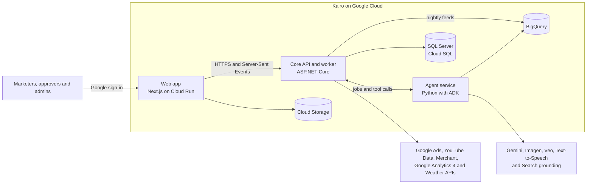
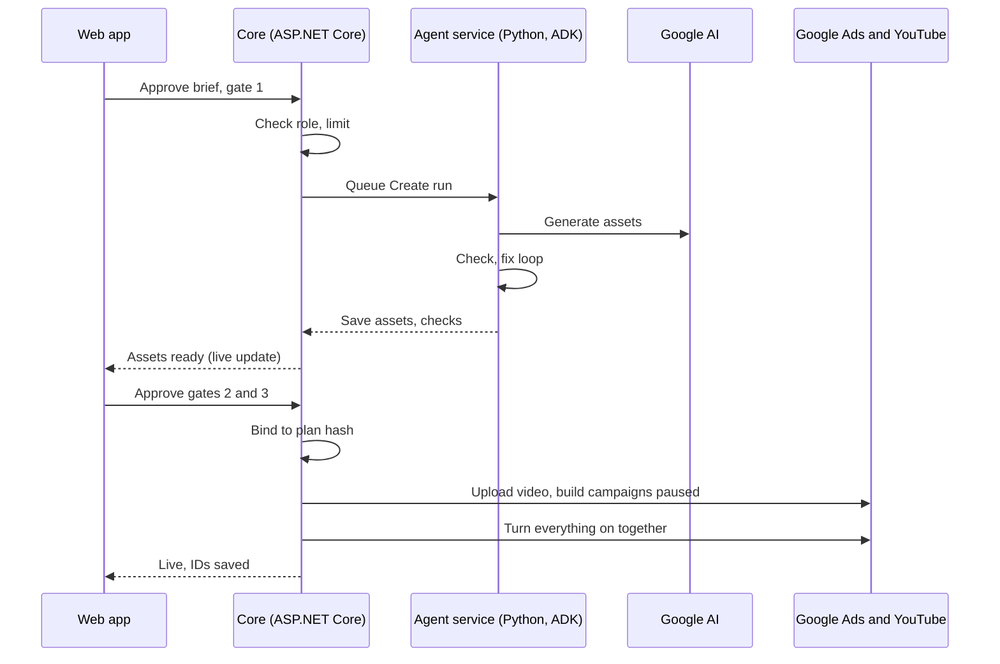

# Kairo — Software Architecture Document

*12 October 2026 · Prepared by Talha*

Kairo runs on Google Cloud in three parts: a Next.js web app, an ASP.NET Core core that owns the data, the approvals and every change to Google Ads, and a Python agent service built with Google's Agent Development Kit. This document sets out the containers, modules, agents, data, integrations, security, deployment and the decisions behind them. It implements the Kairo Business Requirements Document (BRD) and the Kairo Product Requirements Document (PRD).

## 1. Overview

The .NET core runs the campaign lifecycle and is the only part that can change Google Ads. The agents draft, check and measure, then hand their work back to the core.

The web app talks only to the core. The core calls the agent service for each stage and is the only path to Google Ads, YouTube and Merchant Center. Every night it also loads each brand's Google Ads, GA4 and sales data into BigQuery, where the agents read analytics. The agents call Google's models.

### Architecture principles

| Principle | What it means in the design |
| --- | --- |
| The core owns state and money | Campaign states, approvals and every Google Ads change live in the .NET core. Agents never hold Google Ads credentials. |
| Agents advise, code decides | Agents produce drafts, checks and analyses. Rules that protect spend, such as stock pauses and budget limits, are plain code. |
| One record per campaign | The campaign room in SQL Server is the single source of truth that every stage reads and writes. |
| Stateless services, durable jobs | Services keep no state between requests. Long work runs as queued jobs that retry and resume. |
| Managed Google Cloud services | Serverless where possible, and no model training: Kairo uses Google's models as they are. |
| Evidence with every output | Each agent output stores its inputs, sources, model and prompt version, so every recommendation can be explained. |

## 2. Technology stack

Everything runs on Google Cloud, and each part uses the latest stable release of its framework at build time.

| Layer | Technology | Purpose |
| --- | --- | --- |
| Web app | Next.js and React in TypeScript, Tailwind CSS, shadcn/ui on Base UI, the browser's EventSource | Screens, approvals, the Ask Kairo panel and live updates |
| Core service | ASP.NET Core in C#, EF Core, Server-Sent Events, Google Ads API .NET client library, Google API .NET clients | Campaign lifecycle, approvals, schedules, notifications and every change to Google Ads, YouTube and Merchant Center |
| Agent service | Python, Google's Agent Development Kit (ADK), Google Gen AI SDK, FastAPI | The Sense, Plan, Create, Check, Prove and Learn agents, Ask Kairo and lift measurement |
| Measurement | Python with TensorFlow Probability's CausalImpact (tfp-causalimpact) and the BigQuery client | Holdout matching, smallest detectable lift, lift estimates and Impact Lab |
| Media processing | FFmpeg in the agent service container | Adding voiceover, captions and logo to generated video |
| AI models | Gemini (Pro and Flash), Imagen and Gemini image generation, Veo, Grounding with Google Search, on Gemini Enterprise Agent Platform; Cloud Text-to-Speech | Reasoning, copy, checks, images, video, sourced explanations and voiceover |
| Operational database | Cloud SQL for SQL Server | Brands, users, Brand Kits, catalogue, campaign rooms, approvals, trigger rules, Brand Memory and the audit log |
| Analytics | BigQuery, loaded nightly by the core worker from the Google Ads API, the GA4 Data API, sales uploads and the brand's own tables | Performance, sales and stock history, and measurement results |
| Files | Cloud Storage | Brand files, catalogue imports, generated images, video and audio, and report PDFs |
| Jobs and events | Cloud Scheduler (including the nightly `kairo-analytics-daily` run), Cloud Tasks, Pub/Sub | Scheduled refreshes and checks, rate-limited and retried jobs, and events between modules |
| Live updates | A SQL Server outbox, streamed as Server-Sent Events | Agent progress and status changes, pushed to the browser within about a second |
| Identity and secrets | Google OAuth 2.0 client (Google sign-in and account connections), Secret Manager, Cloud KMS | User sign-in, each brand's consent to its Google accounts, API keys, and encrypted OAuth tokens |
| AI safety | Model Armor | Screening untrusted text for prompt injection and malicious links |
| Email | Gmail API, sending as one sender mailbox | Notification emails, sent from an outbox in SQL Server |
| Hosting | Cloud Run | Web app, core API, core worker and agent service |
| Delivery | deploy.bat script with the gcloud CLI, Cloud Build, Artifact Registry | Test, build and deploy each service to Cloud Run |
| Monitoring | Cloud Logging, Cloud Monitoring, Cloud Trace, Error Reporting, OpenTelemetry | Logs, metrics, alerts and end-to-end traces |

## 3. Core service

The core is one .NET codebase deployed twice: the API serves the web app and the agent service, and the worker runs scheduled and queued jobs. Modules talk through interfaces and domain events rather than each other's tables, so any of them can be split out later.

| Module | Owns | Main jobs |
| --- | --- | --- |
| Identity and access | Users, roles, approver assignments, budget limits | Validate Google sign-in tokens; enforce roles and approval rules |
| Brands and connections | Brand workspace, connected accounts, encrypted OAuth tokens | Connect Google Ads, YouTube, Merchant Center, GA4 and BigQuery; refresh tokens |
| Brand Kit | Brand Kit versions, rules, guideline files, best ads | Version and approve the kit; serve the approved version to agents |
| Catalogue | Products, stock levels, feed imports | Import files and feeds; detect stock changes and publish stock events |
| Opportunities | Opportunity cards, scores, evidence, watched and ignored topics | Run the daily refresh; save Sense output; handle accept, save and dismiss |
| Triggers | Trigger rules, firings, cooldowns | Check weather, festival and stock conditions; create triggered opportunities |
| Campaign rooms | Rooms, states, stage runs, briefs, proof plans, assets, checks | Run the lifecycle state machine and queue each stage for the agent service |
| Approvals | Gate requests, decisions, approval tokens | Route approvals, enforce the budget limit and bind each approval to the exact plan |
| Launch | Launch records, Google Ads and YouTube IDs, product-to-ad mapping | Upload videos, build campaigns paused, turn them on together, and apply approved changes and stock pauses |
| Care | Pacing checks, health checks, the stock pause log, recommendations | Watch delivery, pause and resume ads for stock, and queue recommendations |
| Measurement | Test windows, impact reports, Impact Lab analyses, data feed runs, sales uploads and sales sources | Load each brand's Google Ads, GA4 and sales data into BigQuery every night; start Prove runs when a test ends, and store results |
| Brand Memory | Memory entries and where each was used | Save what Learn finds, serve entries to agents and honour removals |
| Notifications | In-app notifications, email digests, preferences | Send in-app notifications as live updates and emails through the Gmail API |
| Audit | Append-only audit log | Record every agent and user action, approval, override and automatic change |

The Launch module is the PRD's Launch agent. It is deterministic code with no model in the loop.

## 4. Agent service

The agent service is a stateless Python app built with ADK, running on Cloud Run with internal-only access. The core calls it once per stage with the campaign room's current state; it returns drafts, checks and analyses, and never writes to Google Ads.

| Agent | ADK pattern | Models | Tools it can use |
| --- | --- | --- | --- |
| Sense | Sequential: score, match to the catalogue, explain | Gemini Flash with Google Search grounding | Keyword metrics, catalogue and Brand Memory, read through the core |
| Plan | Sequential: draft the brief, then the proof plan | Gemini Pro | Brand Kit, keyword metrics, holdout matching and smallest detectable lift |
| Create | Parallel: copy, images, video, shopping titles and translations | Gemini Flash, Imagen and Gemini image generation, Veo, Cloud Text-to-Speech | Brand Kit, catalogue photos and file storage |
| Check (Brand Guardian) | Loop: check, fix and re-check, up to 3 times | Gemini Pro for review; code for format checks | Brand rules, policy guidance and format specs |
| Prove | Sequential: early readings, lift, then recommendations | Python statistics; Gemini Pro for explanations | BigQuery data, the proof plan and Google Ads results |
| Learn | Single agent | Gemini Flash | Impact reports, user edits, dismiss reasons and Brand Memory |
| Ask Kairo | Conversational agent with tools | Gemini Pro | Read tools for the current screen and room, and propose-change tools |
| Brand Kit drafting | One structured call, not an ADK agent: the Gen AI SDK with a Pydantic response schema | Gemini Flash | None; the core reads the website and the best ads and sends them as data |

**Brand Kit drafting** is one structured call, so it uses the Gen AI SDK alone, on Vertex AI's `global` location. The core reads the pages and ads through its safe web client and Google Ads, so the agent service talks only to Gemini.

- **Tools.** Every tool is a typed call to the core's internal API. Read tools return data; write tools only save drafts and proposals. No tool can launch, spend, approve or change Google Ads.
- **Structured output.** Each stage returns JSON that matches its schema, and the core validates it before saving. Format rules, such as headline length and video duration, are checked in code.
- **Untrusted content.** Web pages, catalogue text and search results are passed as data, screened by Model Armor and never followed as instructions.
- **Sessions.** The service keeps no state. Ask Kairo history lives in SQL Server, and the core sends recent turns with each request.
- **Long jobs.** Video generation runs as a long-running operation. The Create job polls it, then adds voiceover, captions and logo.
- **Prompts.** Prompts are versioned with the code, and every stage run records the model and prompt version it used.
- **Measurement.** Holdout regions are matched on past sales and search demand, and the smallest detectable lift comes from simulations on past data. Lift uses a Bayesian structural time-series model (CausalImpact) with the holdout regions as controls. Impact Lab uses the same method with the comparison series the user picks.

## 5. Key flows

The core drives every flow: it moves the campaign room between states, queues agent work through Cloud Tasks and is the only part that calls Google Ads.

Approvals happen in the core, which binds each one to the exact plan. Any change after approval needs a new approval.

### Other flows

1. **Daily opportunity refresh.** Cloud Scheduler starts each brand's refresh before 07:00 local time. The worker pulls keyword volumes and trends from Google Ads for the brand's categories, then queues a Sense run that scores, matches and explains each opportunity and saves the cards.
2. **Triggered opportunity.** The worker checks weather rules hourly against the Weather API forecast, festival rules daily and stock rules on every catalogue update. A rule that fires passes the cooldown and duplicate checks, then Sense and Plan run, so a card with a draft brief is ready within 15 minutes.
3. **Stock pause and resume.** Each catalogue update is compared with the last one. For products now out of stock, the worker checks that the feed is fresh and that no more than 30% of a campaign's ads would pause; the Launch module then pauses the mapped Search and Demand Gen ads and logs it. Restocked products are resumed the same way.
4. **Health and pacing checks.** The worker checks each campaign 24 hours after launch for ad approvals and delivery, then daily for pacing against plan, and raises alerts.
5. **Test end and impact report.** When a test window closes, the core queues a Prove run. It reads Google Ads, sales and GA4 data from BigQuery, estimates lift against the holdout regions and drafts recommendations. Learn then saves the lessons to Brand Memory.
6. **Ask Kairo.** The web app sends the question and the current screen to the core, which adds the user's permissions and recent turns and streams the agent's answer back. A proposed change shows as a preview, and the core applies it through the normal rules once the user confirms.
7. **Live updates.** A change and its live event are written in one transaction: the event goes to a SQL Server outbox. Each core API instance reads new outbox rows about once a second and streams them as Server-Sent Events on `GET /api/brands/{brandId}/live` to that workspace's members, filtered by role or person. Events are signals that tell the screen to refetch. A reconnecting browser sends `Last-Event-ID` and gets what it missed, or a `reset` if that is more than a day old.

## 6. Data architecture

SQL Server holds everything the app reads and writes, BigQuery holds history and analysis, and Cloud Storage holds files. Every SQL Server row carries a brand ID, and row-level security keeps brands apart.

### SQL Server

| Area | Main tables | Notes |
| --- | --- | --- |
| Access | Brand, User, Session, Membership, Invitation, ApprovalDuty, BudgetLimit, Connection | Sessions kept server-side; Connection rows live in the brands schema; OAuth refresh tokens encrypted with Cloud KMS |
| Brand Kit | KitVersion, KitFile, DraftRun | Kit content, rules included, stored as JSON in each version; at most one draft and one approved version; guideline and logo files in Cloud Storage; DraftRun records each drafting run's pages, ads, model and prompt version |
| Catalogue | Product, StockEvent, FeedImport | Current stock on Product; full history in BigQuery |
| Opportunities | Opportunity, WatchTopic | Evidence and sources stored as JSON |
| Triggers | TriggerRule, TriggerFiring | Conditions stored as JSON; cooldown per rule and region |
| Campaign rooms | CampaignRoom, StageRun, Brief, ProofPlan, Asset, CheckResult | Briefs are versioned; each StageRun records model, prompt version, tokens, cost and timing |
| Approvals and launch | Approval, LaunchRecord, ProductAdMap | Approval holds the plan hash; ProductAdMap links products to ads for stock pauses |
| Care and results | Recommendation, ImpactReport, ImpactLabAnalysis | Results and model diagnostics stored as JSON |
| Memory and chat | MemoryEntry, MemoryUse, Conversation, Message | MemoryUse records which entries shaped which output |
| Operations | Notification, EmailOptOut, OutboundEmail, AuditLog, LiveOutbox | AuditLog is append-only; LiveOutbox keeps live updates for 24 hours; OutboundEmail is the email outbox, retried on a fixed schedule |

### BigQuery

| Dataset | Contents | Fed by |
| --- | --- | --- |
| Google Ads | Campaign, ad group, ad and region performance by day | Core worker, nightly, through the Google Ads API |
| GA4 | Sessions, key events, transactions and revenue by region and day | Core worker, nightly, through the GA4 Data API |
| Brand sales | Orders and revenue by region and day | CSV uploads, or a nightly copy of a table in the brand's own BigQuery |
| Kairo history | Keyword trends, opportunity scores, trigger firings and stock history | Core worker, daily |
| Measurement | Lift estimates, Impact Lab results and model diagnostics | Agent service |

Each brand gets its own datasets, starting with `brand_<brand ID>` for these feeds in Kairo's project, so access can be granted and removed per brand. Every load replaces whole days, so a rerun never duplicates rows, and the later of an upload or a table copy wins each day.

### Cloud Storage

Separate buckets hold brand files (`{project}-brand-files`), catalogue imports, generated media and reports. Brand files are private and reach the browser only through the core, as attachments. Other files are served through short-lived signed URLs. Draft media that is never approved expires under a lifecycle rule, and retention for everything else is set per brand.

## 7. Integrations

The core connects to every Google service that holds the brand's ads or data; the agent service connects only to Google's AI services.

| System | Used for | How Kairo connects | Limits to plan for |
| --- | --- | --- | --- |
| Google Ads API | Keyword metrics, performance and recommendations, nightly performance reports; creating campaigns, pausing and resuming ads, budgets and bid targets | The Google Ads REST API from the core, with each brand's OAuth consent through Kairo's OAuth client. Since 9 September 2026 access levels belong to the Google Cloud project behind the OAuth client, and no developer token is sent. | Keyword planning needs Basic access or above, which the `kairo2` project has. Basic allows 15,000 operations a day; Standard has no daily cap. |
| YouTube Data API | Uploading approved videos as unlisted | Google API .NET client in the core, with the brand's channel consent | Uploads have their own limit of 100 a day per project |
| Merchant API | Checking the Merchant Center link and product status, and updating titles if chosen | The Merchant API v1 REST endpoints from the core, with the brand's consent. The Content API for Shopping it replaces was sunset on 18 August 2026. | Shopping needs the Merchant Center account linked to Google Ads |
| Google Maps Platform Weather API | Hourly and daily forecasts for trigger rules | REST from the core worker, with a server-only API key | Billed per call, so forecasts are cached by region and hour |
| Google Analytics 4 | Outcome data for measurement and Impact Lab | The GA4 Data API from the core worker, with the brand's consent, nightly by region and day | Totals only; raw events need the brand's own BigQuery export, which Kairo doesn't read |
| Gemini Enterprise Agent Platform | Gemini, Imagen, Veo and Google Search grounding | Google Gen AI SDK in the agent service | Per-model quotas; Veo and Imagen run in fewer regions than Gemini |
| Cloud Text-to-Speech | Voiceover in each language | Client library in the agent service | Voice choice varies by language |
| Model Armor | Screening untrusted text | API from the agent service | Adds a short delay to each screened call |
| Gmail API | Notification emails | One sender mailbox, a Workspace or Gmail address, signed in once with the gmail.send scope through Kairo's OAuth client. Its refresh token sits in Secret Manager, and the core API sends from an email outbox in SQL Server. | About 500 messages a day from a Gmail account, or 2,000 from a Workspace account |
| Brand website and catalogue feed | Brand Kit and products | HTTPS fetch, or file upload to Cloud Storage | Untrusted content, screened before use |

## 8. Security

Security rests on one rule: money moves only through code that checks a person's approval.

| Area | Design |
| --- | --- |
| Sign-in | Google sign-in through the core's own OAuth client, using OpenID Connect. The core keeps each session in SQL Server behind an httpOnly cookie, and the web app's server code passes that cookie on when it calls the core. |
| Roles | Admin, marketer and approver roles per brand, enforced by ASP.NET Core authorization policies. SQL Server row-level security keeps brands apart. |
| Spend safety | Only the Launch module calls Google Ads write methods. It needs a valid approval whose plan hash matches the current plan, or the stock rule, which can only pause and resume mapped ads. Every call carries an idempotency key. |
| Service access | Cloud Run services accept only Google-signed identity tokens. The agent service accepts calls only from the core, and worker endpoints only from Cloud Scheduler, Cloud Tasks and Pub/Sub. |
| Secrets | The OAuth client secret and API keys sit in Secret Manager. Each brand connection's refresh token is encrypted with the Cloud KMS key `connection-tokens`, which rotates every 90 days, with the brand and connection IDs as additional authenticated data. Only the API and worker service accounts can use the key. |
| Network | Cloud SQL uses a private IP, reached through Direct VPC egress. Public traffic enters through an HTTPS load balancer with Cloud Armor. |
| AI safety | Untrusted text is screened by Model Armor, each agent gets only the tools it needs, outputs are checked against schemas, and no tool can spend money. |
| Audit | An append-only audit log in SQL Server, plus Cloud Audit Logs for platform actions. |
| Privacy | No personal customer data is stored. Sales data is held by region and day, and each brand's data sits in its own rows and datasets. |

## 9. Deployment

Kairo runs in three Google Cloud projects (development, staging and production), each with its own database, buckets, secrets and Google Ads setup. Development and staging use Google Ads test accounts.

| Component | Runs on | Settings |
| --- | --- | --- |
| Web app | Cloud Run service | At least 1 instance; public through the load balancer |
| Core API | Cloud Run service | At least 1 instance; 60-minute request timeout for live update streams; CPU always allocated so the email outbox keeps sending between requests |
| Core worker | Cloud Run service | Scales to zero; 60-minute request timeout; triggered by Cloud Scheduler, Cloud Tasks and Pub/Sub |
| Agent service | Cloud Run service | Internal access only; long request timeout for video jobs |
| Database | Cloud SQL for SQL Server | Express edition for the prototype; Standard with high availability in production; automated backups and point-in-time recovery |
| Queues | Cloud Tasks | Separate queues for agent runs and Google Ads changes, each with its own rate limit. Notification emails go through an outbox in SQL Server, sent by the core API, so they need no queue. |

- **Region.** The app and its data run in asia-south1 (Mumbai), close to Indian brands. Gemini calls can use the global endpoint, while Veo and Imagen run in the nearest region that offers them.
- **Delivery.** `deploy.bat` deploys Kairo with the gcloud CLI, taking the target environment (development, staging or production) as an argument; `deploy/environments.psd1` maps each to its project. It runs the tests, builds each service's container image with Cloud Build into Artifact Registry, runs the Migrator as a Cloud Run job inside the VPC to apply EF Core migrations, then deploys the services to Cloud Run. Shared resources such as the network, database, secrets and service accounts are created once per project by `deploy/setup.ps1`. The development project has no load balancer: the web app forwards `/api/*` to the core with a Google identity token.

## 10. Observability and operations

One trace follows each request from the web app through the core, Cloud Tasks and the agent service, so a slow or failed stage can be pinned to its exact step.

- **Tracing.** OpenTelemetry in all three parts sends traces to Cloud Trace.
- **Logs.** Structured JSON logs carry the brand, campaign room, stage run and trace IDs.
- **Dashboards.** Stage durations against the BRD speed targets, launch success, Google Ads errors and quota use, model latency and errors, and model cost per campaign.
- **Alerts.** Launch failures, a stage run failing twice, mass-pause holds, a stale stock feed, expired Google Ads access, quota use above 80%, and growing queue backlogs.
- **AI quality.** A test set of briefs and assets runs on every prompt or model change, using the Agent Platform's evaluation tools. Brand Guardian is scored on planted issues, as in the PRD release criteria.
- **Cost.** Each stage run records tokens and generation counts, so cost per campaign shows on the dashboard and per-campaign generation limits can be enforced.

## 11. Quality attributes

Each BRD target maps to a specific design choice.

| Quality | Target (BRD) | How the architecture meets it |
| --- | --- | --- |
| Spend safety | No launch or spend increase without approval | One write path in the Launch module, approvals bound to the plan hash, no Google Ads credentials in the agent service, and a stock rule limited to pause and resume |
| Speed | Brief under 1 minute; copy and images under 5 minutes; video under 15 minutes; launch under 5 minutes; trigger to brief under 15 minutes; stock pause within 1 hour | Parallel generation, Flash models for bulk work, keyword data fetched before the refresh, hourly feed checks, and campaigns built in batches |
| Availability | 99.5% a month | Cloud Run across zones, Cloud SQL high availability, retries with idempotency keys, and jobs that resume from saved state |
| Explainability | Every recommendation shows its reasoning | Evidence, sources, model and prompt version saved with each output |
| Scalability | Many campaigns at once for one brand | Stateless services, rate-limited queues, and heavy analysis in BigQuery |
| Security and privacy | Least privilege, encryption and brand separation | See section 8 |
| Cost | Generation stays within budget | Model tiers, caching, per-campaign generation limits, and Express edition for the prototype |

## 12. Architecture decisions

| Decision | Choice | Alternatives considered | Why |
| --- | --- | --- | --- |
| AD-1 Core structure | .NET modular monolith, deployed as API and worker | Microservices | One codebase is faster for a small team, and modules can split out later |
| AD-2 Agent runtime | A separate Python service with ADK | Agents in .NET; ADK in TypeScript | ADK has no .NET SDK, Python is its most complete SDK, and the lift statistics need Python |
| AD-3 Lifecycle owner | A state machine in the core, with one agent run per stage | One long-running agent for the whole campaign | Approvals can take days, so state must be durable, auditable and recoverable |
| AD-4 Google Ads writes | Only the Launch module, with approval tokens | Google Ads tools given to agents | Spend safety becomes a property of the code, not of a prompt |
| AD-5 Operational database | Cloud SQL for SQL Server | Firestore; Cloud SQL for PostgreSQL | Team expertise, relational integrity, row-level security and JSON columns in one store |
| AD-6 Analytics store | BigQuery | Reporting from SQL Server | Per-brand datasets, whole-day loads and time-series analysis at scale |
| AD-7 Campaign build | Create everything paused, then turn it on together | Create live, item by item | A failed launch never leaves half a campaign spending |
| AD-8 Stock pauses | Rule-based code | A model's judgement | Predictable, testable and auditable |
| AD-9 Live updates | Server-Sent Events fed by a SQL Server outbox | SignalR with a Memorystore backplane; Firestore listeners | Events commit with the change they describe, the worker publishes the same way as the API, several API instances need no backplane, and plain HTTP passes through the development project's web proxy and the load balancer |
| AD-10 Model use | Prompting, structured output, grounding and evaluation | Fine-tuning models | No training data needed; the Brand Kit and Brand Memory carry each brand's style |

## 13. Risks and open questions

The biggest technical risk is Google's review of Kairo's OAuth app: connecting brand accounts asks for sensitive scopes, which need OAuth verification before more than 100 users can consent.

| Risk | Impact | Mitigation |
| --- | --- | --- |
| OAuth verification for sensitive scopes | Until `kairo2` is verified, consent shows an "unverified app" warning and is limited to 100 users | Enough for the pilot; submit verification with a privacy policy, homepage, demo video and scope justifications before scaling. Google Ads Basic access is already granted to the project; apply for Standard before scaling. |
| YouTube upload limit | 100 uploads a day per project | Enough at launch; request more quota before scaling |
| Model quotas and regions | Veo or Imagen quota limits, or no regional availability | Request quotas early; fall back to image-only Demand Gen ads |
| Generation cost | Video is the most expensive step | Per-campaign generation limits, cost dashboards and Flash models for bulk work |
| SQL Server licensing | Standard edition adds a licence fee in production | Express edition for the prototype; review usage before production |
| Fast-moving AI SDKs | ADK or model changes can break agents | Upgrade regularly behind the evaluation test set |

### Open questions

- [ ] Must brand data and model processing stay in India? That would rule out the global Gemini endpoint and possibly some models.
- [ ] Who completes OAuth verification for `kairo2`'s sensitive scopes?
- [x] Which Google Workspace account sends notification emails? One dedicated sender mailbox, a Workspace or Gmail address, that signs in once to gmail.send with deploy/set-mail-sender.ps1.
- [ ] Can each brand's stock feed update hourly (a BRD open question)? It sets how often the worker polls.
- [ ] Should Kairo push shopping titles through the Merchant API or export them (a BRD open question)?
