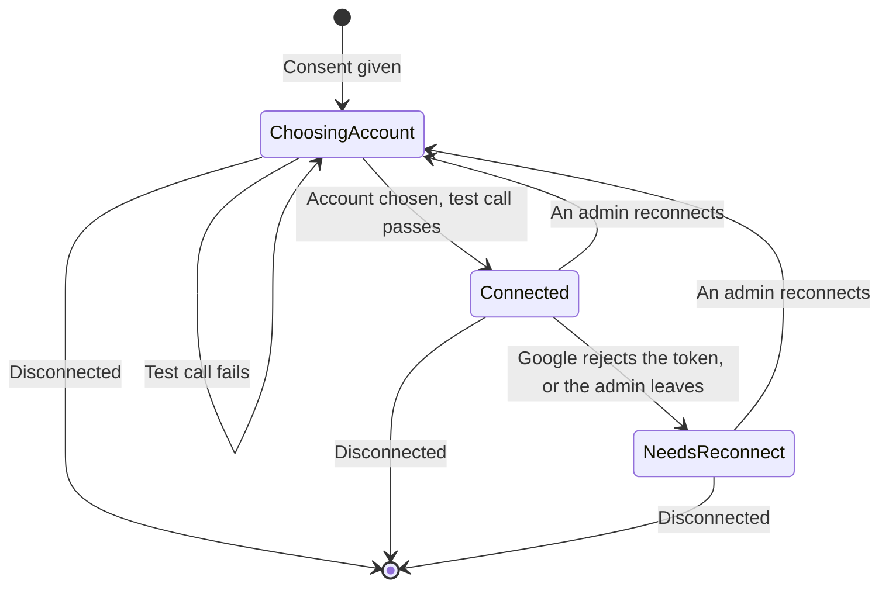

# Kairo Account Connections — design

*13 October 2026 · Approved in conversation; this is the written record*

## Goal

Let a workspace admin connect the brand's Google Ads, YouTube, Merchant Center, Google Analytics 4 and BigQuery accounts with their own Google consent. Kairo lists only the accounts that person can reach and confirms access with a test call. It keeps refresh tokens encrypted with Cloud KMS, and gives later modules one place to get a working access token or learn that access is gone.

Task: `docs/task.md` §1, Talha, **Account connections**. PRD US-1.1, BRD FR-1.1, PRD §11 (access expires or is revoked). The screen is the "connect accounts" part of Nency's **Settings screens** task.

## Decisions

| Decision | Choice | Why |
| --- | --- | --- |
| Whose consent | The admin who clicks Connect, through Kairo's existing OAuth client in `kairo2` | Google Ads API access levels now belong to the Cloud project that owns the OAuth client |
| Granularity | One connection per product, each with its own consent, scopes and refresh token | A workspace can run on Google Ads alone, products disconnect independently, and consent asks only for what's needed |
| Encryption | Cloud KMS, with the brand and connection IDs as additional authenticated data; ASP.NET Data Protection locally and in tests | SAD §8; a ciphertext moved to another row won't decrypt |
| Access tokens | Fetched on demand and cached in memory until a minute before expiry, never stored | Nothing long-lived beyond the encrypted refresh token |
| Departing admin | Their connections move to Needs reconnect and their tokens are revoked | No one's personal Google access outlives their membership. Chosen by the product owner. |
| Merchant Center | Merchant API v1 | The Content API for Shopping was sunset on 18 August 2026 |
| Google APIs | Each behind a small interface, with fakes for tests | Foundations rule: work never waits on Google |
| Comments | None in code | `CLAUDE.md` §3 |

## Notes on the documentation

1. **Developer token.** Google sunset Google Ads API developer tokens on 9 September 2026, and access levels now follow the Google Cloud project behind the OAuth credentials. Kairo's `kairo2` project has Basic access. SAD §2, §5, §8, §13 (the developer token risk) and its open question about the developer token still describe a token in Secret Manager. This task corrects them, and the PRD §11 row stays as it is.
2. **Losing the admin role.** The product owner chose Needs reconnect for an admin who leaves or is removed. Losing the admin role while staying a member is treated the same way, because only admins may hold connections.
3. **Alerting admins.** PRD §9 asks for an email and in-app alert to admins on a connection problem. This task records the change in the audit log. The alert itself comes with the Notifications task, and the live event with whichever of this task and **Live updates** merges second.

## Products

| Product | Scopes requested | Choices listed with | Test call | Stored external ID |
| --- | --- | --- | --- | --- |
| `google-ads` | `https://www.googleapis.com/auth/adwords` | `CustomerService.ListAccessibleCustomers`, then each customer's descriptive name | A `customer` query, then a `CampaignBudgetService` create with `validateOnly` | Customer ID |
| `youtube` | `youtube.readonly`, `youtube.upload` | `channels.list` with `mine=true` | `channels.list` for the chosen channel, and both scopes granted | Channel ID |
| `merchant-center` | `https://www.googleapis.com/auth/content` | Merchant API `accounts.list` | `accounts.get`, and the user's access rights on the account include `STANDARD` or `ADMIN` | Merchant account ID |
| `ga4` | `https://www.googleapis.com/auth/analytics.readonly` | Analytics Admin API `accountSummaries.list`, showing properties | `properties.get` for the chosen property | Property ID |
| `bigquery` | `https://www.googleapis.com/auth/bigquery` | Cloud Resource Manager `projects.search` | `projects.testIamPermissions` for `bigquery.jobs.create` and `bigquery.datasets.get` | Project ID |

GA4 and BigQuery are optional, as PRD journey 3.1 has them.

## States



- A product with no row is **Not connected**.
- Each brand has at most one row per product. Reconnecting replaces the token, and revokes the old one at Google.
- A connection left in **Choosing account** for more than an hour is shown as Not connected and replaced on the next attempt.

## Connecting

1. **Start.** `GET /api/brands/{brandId}/connections/{product}/connect`, for admins only, redirects to Google's authorization endpoint with:
   - the authorization code flow with PKCE
   - that product's scopes only, and `include_granted_scopes=false`
   - `access_type=offline` and `prompt=consent`, so Google always returns a refresh token
   - a `state` value, protected with ASP.NET Data Protection, holding the brand, product, user, PKCE verifier, a nonce and an expiry 10 minutes ahead
2. **Callback.** Google returns to `GET /api/connections/callback/google`. The core:
   - rejects a `state` that doesn't decrypt, has expired, has been used before (the nonce is recorded), or names a different user from the signed-in one
   - re-checks that the user is still an admin of that brand
   - exchanges the code, checks every requested scope was granted, encrypts the refresh token and saves the connection as Choosing account
   - redirects to `/{handle}/settings/connections?choose={product}`
   - on any failure, including the user cancelling at Google, redirects to `/{handle}/settings/connections?error={code}` with a short, stable code (`cancelled`, `scopes_missing`, `expired`, `failed`)
3. **Choose.** `GET /api/brands/{brandId}/connections/{product}/accounts` lists what the consenting person can reach, as ID and display name.
4. **Confirm.** `POST /api/brands/{brandId}/connections/{product}/account` with `{ externalId }`:
   - checks the ID is in the list
   - runs the test call
   - on success, saves the external ID and name and marks the connection Connected
   - on failure, keeps it in Choosing account and returns a 409 problem with a plain-language reason, such as "This Google account can see the Ads account but can't make changes to it."

The callback path sits outside the brand route group, because Google can't send the brand ID. The `state` carries it, and the core sets the brand context from it after checking membership.

## Disconnecting and losing access

- `DELETE /api/brands/{brandId}/connections/{product}`, for admins only, erases the ciphertext, removes the row and revokes the token at Google. Revocation is best effort: a failure is logged, and Kairo's copy is gone either way.
- **Google rejects a refresh.** When Google answers `invalid_grant`, the connection moves to Needs reconnect and its ciphertext is erased. This happens when the user revoked access, changed their password or the token expired.
- **An admin leaves.** When a member is removed, leaves or loses the admin role, Identity calls `IConnections.ReleaseAsync(userId)` for that brand in the same transaction. Every connection they made moves to Needs reconnect, its ciphertext is erased and its token is revoked at Google.

## Contract for other modules

`Kairo.Contracts` gains:

```csharp
public interface IConnections
{
    Task<ConnectionStatus> GetStatusAsync(ConnectedProduct product, CancellationToken cancellationToken);
    Task<ConnectionAccess> GetAccessAsync(ConnectedProduct product, CancellationToken cancellationToken);
    Task ReleaseAsync(Guid userId, CancellationToken cancellationToken);
}

public sealed record ConnectionAccess(string ExternalId, string AccessToken, DateTimeOffset ExpiresAt);
```

- Each method works on the current brand context.
- `GetAccessAsync` throws `ConnectionUnavailableException` when the product isn't connected or Google rejects the token. In the second case it also moves the connection to Needs reconnect.
- Later modules call `GetAccessAsync` before every Google call. A missing or broken connection therefore stops changes and refreshes for that brand, as PRD §11 requires.

## Data

| Schema | Table | Belongs to a workspace | Holds |
| --- | --- | --- | --- |
| `brands` | `Connections` | Yes | Brand, product, state, external ID and display name, granted scopes, refresh token ciphertext (nullable), KMS key version, connected-by user, connected time, last-checked time, needs-reconnect reason |
| `brands` | `ConnectionStates` | No | Used `state` nonces with their expiry, purged after a day |

- There is a unique index on brand and product.
- `Connections` is covered by the `brands` schema's row-level security policy.

## Encryption

- `ITokenCipher` has two methods: `EncryptAsync(plaintext, context)` returns ciphertext and a key version, and `DecryptAsync(ciphertext, context)` returns plaintext.
- `context` is `{brandId}:{connectionId}`.
  - **Cloud KMS:** it is passed as additional authenticated data.
  - **Data Protection:** it is the purpose string.
- KMS is used when `Kairo:Kms:KeyName` is set. Otherwise Data Protection is used, which is the case in Aspire and in tests.
- `deploy/setup.ps1` creates:
  - the `cloudkms.googleapis.com` service
  - the key ring `kairo` in the environment's region
  - the key `connection-tokens`, with 90-day automatic rotation
  - `roles/cloudkms.cryptoKeyEncrypterDecrypter` on that key for the API and worker service accounts
- `deploy.ps1` passes `Kairo__Kms__KeyName` to both services.

## API

These are added to the committed OpenAPI document. Nency's screen builds on them.

| Method and path | Who | What it does |
| --- | --- | --- |
| `GET /api/brands/{brandId}/connections` | Member | Every product with its state, external ID and name, who connected it and when, and the needs-reconnect reason |
| `GET /api/brands/{brandId}/connections/{product}/connect` | Admin | Starts Google consent (a browser navigation, not a fetch) |
| `GET /api/connections/callback/google` | Google | Finishes consent and redirects to the settings page |
| `GET /api/brands/{brandId}/connections/{product}/accounts` | Admin | Accounts the consenting person can reach |
| `POST /api/brands/{brandId}/connections/{product}/account` | Admin | Chooses one and runs the test call |
| `POST /api/brands/{brandId}/connections/{product}/check` | Admin | Refreshes the token and re-runs the test call, updating the last-checked time, or moving the connection to Needs reconnect |
| `DELETE /api/brands/{brandId}/connections/{product}` | Admin | Disconnects |

`product` is one of `google-ads`, `youtube`, `merchant-center`, `ga4` or `bigquery`. Anything else returns 404.

## Audit

The following actions are recorded, with before and after state but never tokens:

- `connection.connected`
- `connection.account_chosen`
- `connection.disconnected`
- `connection.needs_reconnect`, with the reason `token_rejected` or `admin_left`

## Code layout

| Project | Adds |
| --- | --- |
| `Kairo.Contracts` | `IConnections`, `ConnectedProduct`, `ConnectionStatus`, `ConnectionAccess`, `ConnectionUnavailableException` |
| `Kairo.Modules.Brands` | The `Connections` folder: the table and migration, consent and callback endpoints, the account and test-call clients per product, `ITokenCipher` with its KMS and Data Protection versions, the access-token cache, and `IConnections` |
| `Kairo.Modules.Identity` | Calls `ReleaseAsync` on removal, leaving and losing the admin role |

Each Google API is reached through one internal interface per product, `IProductAccounts`, with `ListAsync` and `TestAsync`. Real versions use the official .NET clients (`Google.Ads.GoogleAds` with no developer token, `Google.Apis.YouTube.v3`, `Google.Shopping.Merchant.Accounts.V1`, `Google.Analytics.Admin.V1Beta`, `Google.Apis.CloudResourceManager.v3`), each at its latest stable version, checked when planning. Token exchange, refresh and revocation go through one `IGoogleOAuth` interface.

## Google Cloud setup

The README gains these steps:

1. **Add the scopes.** In Google Auth Platform → Data Access, add the scopes from the products table.
2. **Verify the app.** These scopes are sensitive. Until `kairo2` passes OAuth verification for them, Google shows an "unverified app" warning and limits consent to 100 users. That is enough for the pilot. The README lists what verification needs: a privacy policy, a homepage, a demo video of each scope in use, and a justification for each scope.
3. **Add redirect URIs.** Add `{origin}/api/connections/callback/google` for each environment to the OAuth client.
4. **Enable APIs.** `setup.ps1` enables the Google Ads, YouTube Data, Merchant, Analytics Admin, Cloud Resource Manager and Cloud KMS APIs.

## Testing

**Integration tests** run against fake Google endpoints, which extend the existing `FakeGoogle`, and the fake product interfaces:

- **Permissions.** Members can read, only admins can connect, choose, check and disconnect, and the 401 and 404 rules apply.
- **`state` checks.** Tampered, expired, replayed, and started by a different user are all rejected. A user who stopped being an admin between start and callback is rejected.
- **Scopes.** Missing scopes are rejected.
- **Choosing.**
  - An account not in the list is rejected.
  - A failing test call keeps the connection in Choosing account with its reason.
  - A passing one marks it Connected.
- **Disconnecting.** Erases the ciphertext and revokes the token. A failed revoke still disconnects.
- **Rejected tokens.** `invalid_grant` on refresh leads to Needs reconnect, an erased ciphertext and an audit entry.
- **A departing admin.**
  - Being removed, leaving or being demoted leads to Needs reconnect and revocation.
  - Another admin's connections are untouched.
- **Encryption.** A ciphertext copied to another brand's or connection's row fails to decrypt.
- **Separation.** Brand separation and the security policy cover the new table.
- **Access tokens.** The cache refreshes a token only near expiry.

**Unit tests** cover each product's listing and test-call mapping, and the plain-language failure reasons.

The OpenAPI document test picks up the new endpoints.

## Out of scope

- The web screen (Nency).
- A scheduled daily token check. It needs worker job authentication, so failures are found when a token is next used.
- Emailing admins about connection problems (Notifications).
- BigQuery Data Transfer, the GA4 BigQuery link and sales data (**Analytics data feeds**).
- The product catalogue import, which is §2 of the task list.
- Live events (see note 3).

## Done criteria

1. `dotnet build core/Kairo.slnx` and `dotnet test --solution core/Kairo.slnx` pass with Docker running, with 0 warnings.
2. `npm --prefix web run generate:api` regenerates the types with the new endpoints, and the web checks still pass.
3. The deployment tests pass with the new setup and deploy steps.
4. With Aspire running and the scopes added in `kairo2`, a manual check succeeds:
   - connect the demo Google Ads test account and a YouTube channel through real consent, and see them Connected
   - revoke Kairo's access at myaccount.google.com, and press Check connection and see Google Ads move to Needs reconnect
   - disconnect
5. SAD §2, §5, §8 and §13 and the README are updated.
